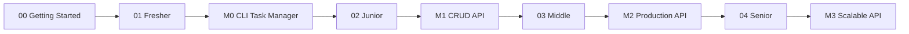

# Lộ trình Python & FastAPI: Fresher → Senior

Chào mừng bạn đến với **Lộ trình học Python & FastAPI toàn diện**, được thiết kế chuyên biệt dành cho các kỹ sư phần mềm đã có kinh nghiệm với **C# / .NET / ASP.NET Core** (và có hiểu biết cơ bản về TypeScript/React/Frontend).

Nếu bạn đã quen thuộc với Dependency Injection, Entity Framework Core, LINQ, Middleware pipeline, async/await của Task Parallel Library (TPL), và cấu trúc Clean Architecture trong C#, lộ trình này sẽ giúp bạn tận dụng tối đa nền tảng vững chắc đó để làm chủ hệ sinh thái Python hiện đại (Python 3.13+, `uv`, FastAPI, Pydantic v2, SQLAlchemy 2.0) mà không phải học lại các khái niệm lập trình căn bản từ con số 0.

---

## 🗺️ Bản đồ học tập tổng quan

Toàn bộ lộ trình kết hợp chặt chẽ giữa lý thuyết chuyên sâu, các bài tập thực hành chuyển dịch tư duy và 4 cột mốc dự án thực chiến (**TaskFlow API**):

---

## 📊 Lộ trình chi tiết theo từng Level

| Level | Thời lượng ước tính | Trọng tâm kiến thức | Milestone dự án |
|---|---|---|---|
| [**00 Getting Started**](./00-getting-started/README.md) | 2–3 ngày | Thiết lập môi trường Python 3.13+, Astral `uv`, `.venv`, cấu hình VS Code (Ruff, Pylance), chuyển dịch tư duy từ C# sang Pythonic. | *Nền tảng thiết lập* |
| [**01 Fresher**](./01-fresher/README.md) | 3–4 tuần | Cú pháp cốt lõi, dynamic typing, collections, list/dict comprehension, hàm, exceptions, OOP, dataclasses, type hints, ruff linter & debugger. | [**M0 – CLI Task Manager**](./project/m0-cli-task-manager.md) |
| [**02 Junior**](./02-junior/README.md) | 4–5 tuần | Generator & iterator, decorator, context manager, typing nâng cao & mypy, pytest, xây dựng web API đầu tiên với FastAPI, Pydantic v2, Dependency Injection. | [**M1 – CRUD API**](./project/m1-crud-api.md) |
| [**03 Middle**](./03-middle/README.md) | 6–8 tuần | Lập trình bất đồng bộ (`asyncio`), SQLAlchemy 2.0 async ORM, database migration với Alembic, Repository & Service pattern, JWT authentication & RBAC, Docker Compose & GitHub Actions CI. | [**M2 – Production API**](./project/m2-production-api.md) |
| [**04 Senior**](./04-senior/README.md) | 2–3 tháng+ | CPython internals & GIL, performance profiling, Redis caching, task queue (Celery/ARQ), WebSockets & SSE, Clean Architecture, OWASP API Security, Observability (OpenTelemetry), System Design & Scalability. | [**M3 – Scalable API**](./project/m3-scalable-api.md) |

---

## 🏗️ Dự án thực hành xuyên suốt: TaskFlow API

Để không học lý thuyết suông, bạn sẽ xây dựng dự án **TaskFlow API** – hệ thống quản lý công việc và dự án cộng tác đa người dùng – qua 4 giai đoạn tiến hóa tương ứng với các level:

- [**Tổng quan dự án TaskFlow API**](./project/README.md): Giới thiệu nghiệp vụ, kiến trúc miền và lộ trình tiến hóa.
- [**Milestone 0: M0 – CLI Task Manager**](./project/m0-cli-task-manager.md): Ứng dụng dòng lệnh (CLI) thuần Python, quản lý task cá nhân, lưu trữ file JSON, áp dụng OOP và Type Hints.
- [**Milestone 1: M1 – CRUD API**](./project/m1-crud-api.md): Chuyển đổi thành RESTful Web API với FastAPI, Pydantic v2 validation, in-memory repository và bộ kiểm thử tự động với pytest & httpx.
- [**Milestone 2: M2 – Production API**](./project/m2-production-api.md): Tích hợp PostgreSQL với SQLAlchemy 2.0 async, Alembic migrations, xác thực JWT, phân quyền theo vai trò (RBAC), đóng gói Docker Compose và CI pipeline tự động.
- [**Milestone 3: M3 – Scalable API**](./project/m3-scalable-api.md): Mở rộng kiến trúc chịu tải cao: Redis caching, asynchronous background workers, thông báo realtime qua WebSocket, OpenTelemetry tracing/metrics, và rate-limiting.

---

## 📚 Phụ lục tra cứu nhanh

Dành riêng cho developer C# khi cần đối chiếu nhanh cú pháp và mô hình kiến trúc:

- [**C# vs Python Cheat Sheet**](./appendix/csharp-vs-python.md): Bảng đối chiếu song song cú pháp C# (.NET 8/9) và Python (3.13+): từ vòng lặp, LINQ vs Comprehensions, Record vs Dataclass đến Async/Await.
- [**Thuật ngữ & Khái niệm (Glossary)**](./appendix/glossary.md): Tra cứu định nghĩa các khái niệm đặc thù trong Python (CPython, GIL, Dunder methods, Duck Typing, ASGI, venv...).
- [**Tài nguyên học tập chọn lọc**](./appendix/resources.md): Tổng hợp sách hay, bài viết chuyên sâu, podcast, và tài liệu kỹ thuật chính thức nên đọc.
- [**Bảng tự đánh giá năng lực**](./appendix/self-assessment.md): Checklist câu hỏi và bài tập tự lượng giá trình độ từ Fresher đến Senior.

---

## 💡 Phương pháp học tập hiệu quả

Để đạt kết quả cao nhất từ tài liệu này, bạn nên tuân thủ chu trình 5 bước:

1. **Đọc kỹ lý thuyết & phần so sánh C#**: Hãy chú ý các điểm khác biệt ngầm giữa C# và Python (như cơ chế truthiness, mô hình bộ nhớ reference counting, hoặc cách DI hoạt động trong FastAPI).
2. **Tự tay gõ lại code ví dụ**: Không copy-paste. Hãy gõ code vào VS Code, chạy thử bằng `uv run` để ghi nhớ cú pháp và quan sát kết quả thực thi.
3. **Tự giải bài tập trước khi xem gợi ý**: Mỗi bài học đều có bài tập thực tế. Hãy cố gắng tự viết code giải quyết trước khi click mở `

💡 Gợi ý
...
`.
4. **Triển khai Milestone dự án**: Sau khi hoàn thành mỗi level, hãy độc lập triển khai milestone tương ứng trong `project/` để tổng hợp toàn bộ kỹ năng.
5. **Đánh dấu Checklist tự đánh giá**: Rà soát lại checklist ở cuối mỗi bài để đảm bảo bạn đã nắm vững toàn bộ khái niệm cốt lõi trước khi bước sang bài tiếp theo.

<!-- nav:bottom -->
---

[Bắt đầu: Getting Started ➡️](./00-getting-started/README.md)
<!-- /nav:bottom -->
