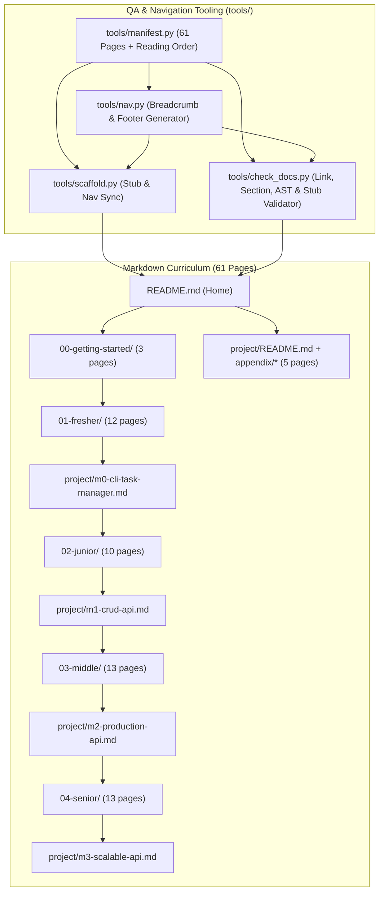

# Python & FastAPI Roadmap (Fresher → Senior) Implementation Plan

> **For agentic workers:** REQUIRED SUB-SKILL: Use superpowers:subagent-driven-development to implement this plan task-by-task. Steps use checkbox (`- [ ]`) syntax for tracking.

**Goal:** Xây dựng bộ tài liệu tự học Python & FastAPI từ Fresher đến Senior (61 trang Markdown liên kết chặt chẽ, dành cho developer có nền tảng C#/ASP.NET) kèm bộ công cụ kiểm tra tự động link, điều hướng, cấu trúc mục và cú pháp code.

**Architecture:** Một manifest duy nhất (`tools/manifest.py`) định nghĩa toàn bộ 61 trang và luồng đọc tuyến tính. Công cụ `tools/scaffold.py` tạo 61 trang khung (stub) và tự động sinh thanh breadcrumb (`<!-- nav:top -->`) cùng footer chuyển trang (`<!-- nav:bottom -->`). Công cụ `tools/check_docs.py` kiểm tra toàn bộ link tương đối, các mục bắt buộc theo loại trang, link mục lục bắt buộc, cú pháp các khối ` ```python ` bằng `ast.parse`, và trạng thái stub (`--no-stub` / `--strict`). Sau khi Task 1 dựng khung 61 trang, các Task 2–11 biên soạn nội dung chi tiết cho từng cụm bài học và dự án TaskFlow API.

**Architecture Diagram:**



**Tech Stack:** Markdown (GitHub Flavored Markdown + Mermaid), Python 3.12+ stdlib (`ast`, `pathlib`, `posixpath`, `re`, `argparse`), `pytest` (chạy qua `uv run --no-project --with pytest pytest`). Nội dung bài học giảng dạy Python 3.13+, `uv`, `ruff`, `mypy`, FastAPI, Pydantic v2, SQLAlchemy 2.0 (async), Alembic, PostgreSQL, Redis, `pytest` + `httpx`, Docker, GitHub Actions, OpenTelemetry.

**Spec:** [2026-10-22-python-fastapi-roadmap-design.md](file:///home/manpham/projects/learning/pythonfastapi/docs/superpowers/specs/2026-10-22-python-fastapi-roadmap-design.md)

## Global Constraints

- Ngôn ngữ tài liệu: Tiếng Việt, giữ nguyên thuật ngữ kỹ thuật tiếng Anh (`dependency injection`, `type hint`, `coroutine`, `event loop`, `unit of work`, v.v.).
- Đối tượng người học: Developer làm việc chính với **C# / ASP.NET Core**, biết một chút TypeScript/React, chưa biết Python và FastAPI. Mọi khái niệm tương đương đều phải đối chiếu trực tiếp với C#/.NET.
- Liên kết nội bộ: Chỉ dùng link tương đối chuẩn Markdown `[text](./path.md)` hoặc `[text](../folder/path.md)`. Không dùng đường dẫn tuyệt đối `/...`, không dùng wikilink `[[...]]`.
- Điều hướng tự động: Không sửa tay nội dung giữa `<!-- nav:top -->...<!-- /nav:top -->` và `<!-- nav:bottom -->...<!-- /nav:bottom -->`. Luôn chạy `python3 -m tools.scaffold` sau khi viết hoặc sửa file `.md`.
- Template bài học (`kind == "lesson"`): Bắt buộc có đủ các heading cấp 2 (`## `) chứa cụm từ: `Mục tiêu`, `Lý thuyết`, `Ví dụ`, `Lỗi thường gặp`, `Bài tập`, `Checklist tự đánh giá`, `Đọc thêm`, và khuyến khích `## 🔁 So sánh với C# / ASP.NET` ở mọi bài có khái niệm tương đương. Phần `Bài tập` có 2–4 bài kèm gợi ý trong `<details><summary>💡 Gợi ý</summary>...</details>`.
- Template README của level (`kind == "level"`): Bắt buộc có `## 🎯 Mục tiêu đầu ra` và `## 📚 Mục lục` chứa link tới toàn bộ bài học của level, milestone dự án của level (với level 01–04), và `[Tự đánh giá](../appendix/self-assessment.md)`.
- Template Milestone dự án (`kind == "milestone"`): Bắt buộc có các heading `## ` chứa: `Bối cảnh`, `Yêu cầu chức năng`, `Yêu cầu kỹ thuật`, `Gợi ý cấu trúc thư mục`, `Gợi ý triển khai`, `Definition of Done`, `Thử thách thêm`.
- Code block Python: Mọi khối ` ```python ` trong tài liệu phải hợp lệ cú pháp Python 3 (được kiểm tra tự động bằng `ast.parse`). Nếu cần minh họa cú pháp lỗi cố ý hoặc pseudo-code không parse được, đặt `<!-- nocheck -->` ngay dòng trên ` ```python `.

---

### Task 1: Bộ công cụ QA (`tools/`) và khởi tạo khung 61 trang Markdown

**Files:**
- Create: [`.gitignore`](file:///home/manpham/projects/learning/pythonfastapi/.gitignore)
- Create: [`pytest.ini`](file:///home/manpham/projects/learning/pythonfastapi/pytest.ini)
- Create: [`tools/__init__.py`](file:///home/manpham/projects/learning/pythonfastapi/tools/__init__.py)
- Create: [`tools/manifest.py`](file:///home/manpham/projects/learning/pythonfastapi/tools/manifest.py)
- Create: [`tools/nav.py`](file:///home/manpham/projects/learning/pythonfastapi/tools/nav.py)
- Create: [`tools/scaffold.py`](file:///home/manpham/projects/learning/pythonfastapi/tools/scaffold.py)
- Create: [`tools/check_docs.py`](file:///home/manpham/projects/learning/pythonfastapi/tools/check_docs.py)
- Create: [`tests/test_nav.py`](file:///home/manpham/projects/learning/pythonfastapi/tests/test_nav.py)
- Create: [`tests/test_check_docs.py`](file:///home/manpham/projects/learning/pythonfastapi/tests/test_check_docs.py)
- Modify: [`docs/superpowers/specs/2026-10-22-python-fastapi-roadmap-design.md`](file:///home/manpham/projects/learning/pythonfastapi/docs/superpowers/specs/2026-10-22-python-fastapi-roadmap-design.md) (commit các cập nhật spec hiện có)

**Interfaces:**
- Consumes: Danh sách 61 trang và quy tắc điều hướng từ spec.
- Produces:
  - `tools.manifest`: `Page`, `ALL_PAGES`, `READING_ORDER`, `BY_PATH`, `required_links(page: Page) -> list[Page]`
  - `tools.nav`: `rel(src: str, dst: str) -> str`, `breadcrumb(page: Page) -> str`, `footer(page: Page) -> str`, `stub(page: Page) -> str`, `apply_nav(text: str, page: Page) -> str`
  - `tools.scaffold`: CLI `python3 -m tools.scaffold`
  - `tools.check_docs`: CLI `python3 -m tools.check_docs [--strict] [--no-stub PATH ...]`
  - 61 file `.md` dạng stub có sẵn `<!-- nav:top -->` và `<!-- nav:bottom -->`.

- [ ] **Step 1: Tạo `.gitignore`, `pytest.ini`, `tools/__init__.py` và viết unit tests cho `nav` và `check_docs`**

Tạo `.gitignore`:
```gitignore
__pycache__/
.pytest_cache/
.venv/
.ruff_cache/
.mypy_cache/
```

Tạo `pytest.ini`:
```ini
[pytest]
pythonpath = .
testpaths = tests
```

Tạo file rỗng `tools/__init__.py`.

Tạo `tests/test_nav.py`:
```python
from tools.manifest import ALL_PAGES, BY_PATH, M0, M3, READING_ORDER
from tools.nav import apply_nav, bottom_block, breadcrumb, footer, rel, stub, top_block


def test_rel_same_folder_parent_and_child():
    assert rel("01-fresher/02-control-flow.md", "01-fresher/README.md") == "./README.md"
    assert rel("01-fresher/02-control-flow.md", "README.md") == "../README.md"
    assert rel("README.md", "01-fresher/README.md") == "./01-fresher/README.md"


def test_manifest_has_61_unique_pages():
    assert len(ALL_PAGES) == 61
    assert len(BY_PATH) == 61


def test_lesson_breadcrumb():
    page = BY_PATH["01-fresher/03-collections.md"]
    assert breadcrumb(page) == "[🏠 Home](../README.md) › [Fresher](./README.md) › Bài 03"


def test_first_lesson_footer_points_back_to_level_index():
    page = BY_PATH["01-fresher/01-syntax-variables-types.md"]
    assert footer(page) == (
        "[⬅️ Fresher](./README.md) | [📚 Mục lục Fresher](./README.md) | "
        "[Điều kiện & vòng lặp ➡️](./02-control-flow.md)"
    )


def test_last_lesson_leads_to_milestone_then_next_level():
    last = BY_PATH["01-fresher/11-tooling-ruff-debugging.md"]
    assert footer(last).endswith("[M0 – CLI Task Manager ➡️](../project/m0-cli-task-manager.md)")
    assert footer(M0).endswith("[Junior ➡️](../02-junior/README.md)")


def test_getting_started_last_lesson_goes_to_fresher():
    page = BY_PATH["00-getting-started/02-python-for-csharp-devs.md"]
    assert footer(page).endswith("[Fresher ➡️](../01-fresher/README.md)")


def test_final_milestone_returns_home():
    assert READING_ORDER[-1] == M3
    assert footer(M3).endswith("[🏁 Hoàn thành – về Home](../README.md)")


def test_home_has_no_breadcrumb_and_a_start_link():
    home = READING_ORDER[0]
    assert top_block(home) == ""
    assert footer(home) == "[Bắt đầu: Getting Started ➡️](./00-getting-started/README.md)"


def test_apply_nav_is_idempotent_and_replaces_stale_blocks():
    page = BY_PATH["02-junior/04-pytest-basics.md"]
    fresh = stub(page)
    assert apply_nav(fresh, page) == fresh
    stale = fresh.replace("Bài 04", "Bài 99")
    assert apply_nav(stale, page) == fresh


def test_apply_nav_adds_missing_blocks():
    page = BY_PATH["appendix/glossary.md"]
    result = apply_nav("# Thuật ngữ\n", page)
    assert top_block(page) in result
    assert bottom_block(page) in result
```

Tạo `tests/test_check_docs.py`:
```python
from pathlib import Path

from tools.check_docs import check_links, check_python_blocks, check_sections, run_checks
from tools.manifest import BY_PATH
from tools.scaffold import scaffold


def test_check_links_reports_broken_and_absolute_ignores_external_and_code(tmp_path: Path):
    (tmp_path / "a.md").write_text("x", encoding="utf-8")
    text = (
        "[ok](./a.md#part) [web](https://fastapi.tiangolo.com) [anchor](#top)\n"
        "`[inline](./nope.md)`\n"
        "```markdown\n[fenced](./nope.md)\n```\n"
        "[bad](./missing.md) [abs](/a.md)\n"
    )
    assert check_links("b.md", text, tmp_path) == [
        "b.md: broken link -> ./missing.md",
        "b.md: absolute link not allowed -> /a.md",
    ]


def test_check_sections_lists_missing_lesson_sections():
    page = BY_PATH["01-fresher/02-control-flow.md"]
    text = "## 🎯 Mục tiêu\n## 📖 Lý thuyết\n## 💻 Ví dụ\n## ⚠️ Lỗi thường gặp\n## 🏋️ Bài tập\n"
    assert check_sections(page, text) == [
        "01-fresher/02-control-flow.md: missing section 'Checklist tự đánh giá'",
        "01-fresher/02-control-flow.md: missing section 'Đọc thêm'",
    ]


def test_check_python_blocks_flags_syntax_errors_unless_nocheck():
    good = "```python\nx: int = 1\n```\n"
    skipped = "<!-- nocheck -->\n```python\ndef broken(:\n```\n"
    indented = "1. Step\n\n   ```python\n   print('hi')\n   ```\n"
    assert check_python_blocks("p.md", good + skipped + indented) == []
    errors = check_python_blocks("p.md", "```python\ndef broken(:\n```\n")
    assert len(errors) == 1
    assert "python syntax error" in errors[0]


def test_scaffolded_tree_passes_and_strict_reports_every_stub(tmp_path: Path):
    scaffold(tmp_path)
    assert run_checks(tmp_path) == []
    assert run_checks(tmp_path, no_stub={"README.md"}) == ["README.md: still a stub"]
    strict = run_checks(tmp_path, strict=True)
    assert len(strict) == 61
    assert all(error.endswith("still a stub") for error in strict)


def test_orphans_and_missing_toc_links_are_reported(tmp_path: Path):
    scaffold(tmp_path)
    (tmp_path / "extra.md").write_text("# Extra\n", encoding="utf-8")
    home = tmp_path / "README.md"
    home.write_text(home.read_text(encoding="utf-8").replace("<!-- STUB -->", "Nội dung"), encoding="utf-8")
    errors = run_checks(tmp_path)
    assert "extra.md: not listed in tools/manifest.py" in errors
    assert "README.md: missing link to 01-fresher/README.md" in errors
```

- [ ] **Step 2: Chạy pytest để xác nhận test fail do chưa có implementation**

Run: `uv run --no-project --with pytest pytest -q`
Expected: FAIL với `ModuleNotFoundError: No module named 'tools.manifest'`

- [ ] **Step 3: Viết `tools/manifest.py`, `tools/nav.py`, `tools/scaffold.py`, `tools/check_docs.py`**

Tạo `tools/manifest.py`:
```python
"""Single source of truth for every page of the roadmap and its reading order."""

from __future__ import annotations

import posixpath
from dataclasses import dataclass
from typing import Literal

Kind = Literal["home", "level", "lesson", "milestone", "reference"]


@dataclass(frozen=True)
class Page:
    path: str  # POSIX path relative to the repo root
    title: str
    kind: Kind
    section: str = ""  # display name of the owning level / section

    @property
    def folder(self) -> str:
        return posixpath.dirname(self.path)


def _level(folder: str, name: str, lessons: list[tuple[str, str]]) -> list[Page]:
    index = Page(f"{folder}/README.md", name, "level", name)
    return [index, *(Page(f"{folder}/{slug}.md", title, "lesson", name) for slug, title in lessons)]


HOME = Page("README.md", "Lộ trình Python & FastAPI: Fresher → Senior", "home")

PROJECT = "Dự án TaskFlow"
PROJECT_INDEX = Page("project/README.md", PROJECT, "reference", PROJECT)
M0 = Page("project/m0-cli-task-manager.md", "M0 – CLI Task Manager", "milestone", PROJECT)
M1 = Page("project/m1-crud-api.md", "M1 – CRUD API", "milestone", PROJECT)
M2 = Page("project/m2-production-api.md", "M2 – Production API", "milestone", PROJECT)
M3 = Page("project/m3-scalable-api.md", "M3 – Scalable API", "milestone", PROJECT)

GETTING_STARTED = _level(
    "00-getting-started",
    "Getting Started",
    [
        ("01-setup-environment", "Cài đặt môi trường"),
        ("02-python-for-csharp-devs", "Python cho dev C#"),
    ],
)
FRESHER = _level(
    "01-fresher",
    "Fresher",
    [
        ("01-syntax-variables-types", "Cú pháp, biến & kiểu dữ liệu"),
        ("02-control-flow", "Điều kiện & vòng lặp"),
        ("03-collections", "Collections: list, tuple, dict, set"),
        ("04-comprehensions", "Comprehension"),
        ("05-functions", "Hàm"),
        ("06-modules-packages", "Module & package"),
        ("07-exceptions", "Exceptions"),
        ("08-file-io-json", "File I/O & JSON"),
        ("09-oop-dataclasses", "OOP & dataclass"),
        ("10-type-hints-basics", "Type hints cơ bản"),
        ("11-tooling-ruff-debugging", "Công cụ: ruff & debugging"),
    ],
)
JUNIOR = _level(
    "02-junior",
    "Junior",
    [
        ("01-iterators-generators", "Iterator & generator"),
        ("02-decorators-context-managers", "Decorator & context manager"),
        ("03-advanced-typing-mypy", "Typing nâng cao & mypy"),
        ("04-pytest-basics", "pytest cơ bản"),
        ("05-fastapi-first-app", "FastAPI đầu tiên"),
        ("06-pydantic-v2", "Pydantic v2"),
        ("07-error-handling", "Xử lý lỗi trong FastAPI"),
        ("08-dependency-injection", "Dependency Injection"),
        ("09-project-structure-settings", "Cấu trúc project & settings"),
    ],
)
MIDDLE = _level(
    "03-middle",
    "Middle",
    [
        ("01-async-asyncio", "Async & asyncio"),
        ("02-sqlalchemy-orm", "SQLAlchemy 2.0 ORM"),
        ("03-alembic-migrations", "Alembic migrations"),
        ("04-repository-service-layer", "Repository & Service layer"),
        ("05-authentication-jwt", "Authentication với JWT"),
        ("06-authorization", "Authorization"),
        ("07-testing-fastapi", "Testing FastAPI"),
        ("08-middleware-lifespan-background", "Middleware, lifespan & background tasks"),
        ("09-pagination-filtering", "Phân trang, lọc & sắp xếp"),
        ("10-logging-error-handling", "Logging & xử lý lỗi toàn cục"),
        ("11-docker-compose", "Docker & docker-compose"),
        ("12-ci-github-actions", "CI với GitHub Actions"),
    ],
)
SENIOR = _level(
    "04-senior",
    "Senior",
    [
        ("01-python-internals-concurrency", "Python internals & concurrency"),
        ("02-profiling-performance", "Profiling & hiệu năng"),
        ("03-caching-redis", "Caching với Redis"),
        ("04-task-queues", "Task queue"),
        ("05-websockets-sse", "WebSocket & SSE"),
        ("06-clean-architecture", "Clean Architecture"),
        ("07-advanced-api-design", "Thiết kế API nâng cao"),
        ("08-security-owasp", "Bảo mật: OWASP API Top 10"),
        ("09-observability", "Observability"),
        ("10-production-deployment", "Deploy production"),
        ("11-system-design-scaling", "System design & scaling"),
        ("12-senior-soft-skills", "Kỹ năng senior"),
    ],
)

APPENDIX = [
    Page("appendix/csharp-vs-python.md", "C# vs Python", "reference", "Phụ lục"),
    Page("appendix/glossary.md", "Thuật ngữ", "reference", "Phụ lục"),
    Page("appendix/resources.md", "Tài nguyên học", "reference", "Phụ lục"),
    Page("appendix/self-assessment.md", "Tự đánh giá", "reference", "Phụ lục"),
]
SELF_ASSESSMENT = APPENDIX[3]

LEVELS = [GETTING_STARTED, FRESHER, JUNIOR, MIDDLE, SENIOR]
MILESTONE_OF_LEVEL = {"01-fresher": M0, "02-junior": M1, "03-middle": M2, "04-senior": M3}

READING_ORDER = [HOME, *GETTING_STARTED, *FRESHER, M0, *JUNIOR, M1, *MIDDLE, M2, *SENIOR, M3]
REFERENCE_PAGES = [PROJECT_INDEX, *APPENDIX]
ALL_PAGES = [*READING_ORDER, *REFERENCE_PAGES]
BY_PATH = {page.path: page for page in ALL_PAGES}


def level_index(page: Page) -> Page:
    """README of the level folder that owns `page`."""
    return BY_PATH[f"{page.folder}/README.md"]


def required_links(page: Page) -> list[Page]:
    """Pages that `page` must link to once it is no longer a stub (its table of contents)."""
    if page.kind == "home":
        return [level[0] for level in LEVELS] + REFERENCE_PAGES
    if page.kind == "level":
        lessons = [p for p in ALL_PAGES if p.kind == "lesson" and p.folder == page.folder]
        milestone = MILESTONE_OF_LEVEL.get(page.folder)
        return [*lessons, *([milestone] if milestone else []), SELF_ASSESSMENT]
    if page == PROJECT_INDEX:
        return [M0, M1, M2, M3]
    if page == SELF_ASSESSMENT:
        return [level[0] for level in LEVELS]
    return []
```

Tạo `tools/nav.py`:
```python
"""Render breadcrumb / footer navigation blocks from the manifest."""

from __future__ import annotations

import posixpath
import re

from tools.manifest import HOME, PROJECT_INDEX, READING_ORDER, Page, level_index

TOP_START, TOP_END = "<!-- nav:top -->", "<!-- /nav:top -->"
BOTTOM_START, BOTTOM_END = "<!-- nav:bottom -->", "<!-- /nav:bottom -->"
STUB_MARKER = "<!-- STUB -->"

_TOP_RE = re.compile(re.escape(TOP_START) + r".*?" + re.escape(TOP_END), re.DOTALL)
_BOTTOM_RE = re.compile(re.escape(BOTTOM_START) + r".*?" + re.escape(BOTTOM_END), re.DOTALL)


def rel(src: str, dst: str) -> str:
    """Relative link from page `src` to page `dst` (both repo-relative POSIX paths)."""
    result = posixpath.relpath(dst, posixpath.dirname(src) or ".")
    return result if result.startswith("../") else f"./{result}"


def link(src: Page, dst: Page, label: str) -> str:
    return f"[{label}]({rel(src.path, dst.path)})"


def breadcrumb(page: Page) -> str:
    if page.kind == "home":
        return ""
    home = link(page, HOME, "🏠 Home")
    if page.kind == "level":
        return f"{home} › {page.section}"
    if page.kind == "lesson":
        number = posixpath.basename(page.path)[:2]
        return f"{home} › {link(page, level_index(page), page.section)} › Bài {number}"
    if page.kind == "milestone":
        short = page.title.split(" – ")[0]
        return f"{home} › {link(page, PROJECT_INDEX, PROJECT_INDEX.title)} › {short}"
    if page == PROJECT_INDEX:
        return f"{home} › {page.title}"
    return f"{home} › {page.section} › {page.title}"


def footer(page: Page) -> str:
    if page.kind == "reference":
        return link(page, HOME, "🏠 Về trang chủ")
    index = READING_ORDER.index(page)
    if page.kind == "home":
        first = READING_ORDER[1]
        return link(page, first, f"Bắt đầu: {first.title} ➡️")
    prev = READING_ORDER[index - 1]
    left = link(page, prev, f"⬅️ {prev.title}")
    if page.kind == "lesson":
        middle = link(page, level_index(page), f"📚 Mục lục {page.section}")
    elif page.kind == "milestone":
        middle = link(page, PROJECT_INDEX, f"📚 {PROJECT_INDEX.title}")
    else:
        middle = link(page, HOME, "🏠 Home")
    if index + 1 < len(READING_ORDER):
        nxt = READING_ORDER[index + 1]
        right = link(page, nxt, f"{nxt.title} ➡️")
    else:
        right = link(page, HOME, "🏁 Hoàn thành – về Home")
    return f"{left} | {middle} | {right}"


def top_block(page: Page) -> str:
    crumb = breadcrumb(page)
    return f"{TOP_START}\n{crumb}\n{TOP_END}" if crumb else ""


def bottom_block(page: Page) -> str:
    return f"{BOTTOM_START}\n---\n\n{footer(page)}\n{BOTTOM_END}"


def stub(page: Page) -> str:
    parts = [top_block(page), f"# {page.title}", STUB_MARKER, bottom_block(page)]
    return "\n\n".join(part for part in parts if part) + "\n"


def apply_nav(text: str, page: Page) -> str:
    """Insert or refresh both nav blocks; everything else in `text` is preserved."""
    top = top_block(page)
    if _TOP_RE.search(text):
        text = _TOP_RE.sub(lambda _: top, text, count=1)
    elif top:
        text = f"{top}\n\n{text}"
    bottom = bottom_block(page)
    if _BOTTOM_RE.search(text):
        text = _BOTTOM_RE.sub(lambda _: bottom, text, count=1)
    else:
        text = f"{text.rstrip()}\n\n{bottom}\n"
    return text
```

Tạo `tools/scaffold.py`:
```python
"""Create missing pages as stubs and (re)write nav blocks on every page. Idempotent."""

from __future__ import annotations

import sys
from pathlib import Path

from tools.manifest import ALL_PAGES
from tools.nav import apply_nav, stub

ROOT = Path(__file__).resolve().parent.parent


def scaffold(root: Path) -> tuple[int, int]:
    """Return (created, updated) page counts."""
    created = updated = 0
    for page in ALL_PAGES:
        path = root / page.path
        if not path.exists():
            path.parent.mkdir(parents=True, exist_ok=True)
            path.write_text(stub(page), encoding="utf-8")
            created += 1
            continue
        old = path.read_text(encoding="utf-8")
        new = apply_nav(old, page)
        if new != old:
            path.write_text(new, encoding="utf-8")
            updated += 1
    return created, updated


def main() -> int:
    created, updated = scaffold(ROOT)
    print(f"scaffold: created={created} updated={updated} total={len(ALL_PAGES)}")
    return 0


if __name__ == "__main__":
    sys.exit(main())
```

Tạo `tools/check_docs.py`:
```python
"""Validate the roadmap: links, navigation, required sections, Python snippets, stubs."""

from __future__ import annotations

import argparse
import ast
import posixpath
import re
import sys
import textwrap
from pathlib import Path

from tools.manifest import ALL_PAGES, BY_PATH, Page, required_links
from tools.nav import STUB_MARKER, bottom_block, top_block

ROOT = Path(__file__).resolve().parent.parent
EXCLUDED_DIRS = {".git", ".agents", ".venv", ".pytest_cache", "docs", "tools", "tests", "node_modules"}

FENCE_RE = re.compile(r"^([ \t]*)```.*?^\1```", re.DOTALL | re.MULTILINE)
INLINE_CODE_RE = re.compile(r"`[^`\n]*`")
LINK_RE = re.compile(r"\]\(([^)\s]+)\)")
PY_BLOCK_RE = re.compile(
    r"(<!-- nocheck -->[ \t]*\n)?^([ \t]*)```python[ \t]*\n(.*?)^\2```", re.DOTALL | re.MULTILINE
)

SECTIONS: dict[str, tuple[str, ...]] = {
    "lesson": (
        "Mục tiêu",
        "Lý thuyết",
        "Ví dụ",
        "Lỗi thường gặp",
        "Bài tập",
        "Checklist tự đánh giá",
        "Đọc thêm",
    ),
    "milestone": (
        "Bối cảnh",
        "Yêu cầu chức năng",
        "Yêu cầu kỹ thuật",
        "Gợi ý cấu trúc thư mục",
        "Gợi ý triển khai",
        "Definition of Done",
        "Thử thách thêm",
    ),
    "level": ("Mục tiêu đầu ra", "Mục lục"),
}


def strip_code(text: str) -> str:
    return INLINE_CODE_RE.sub("", FENCE_RE.sub("", text))


def _local_targets(text: str) -> list[str]:
    return [
        t for t in LINK_RE.findall(strip_code(text)) if not t.startswith(("http://", "https://", "mailto:", "#"))
    ]


def _resolve(page_path: str, target: str) -> str:
    return posixpath.normpath(posixpath.join(posixpath.dirname(page_path), target.split("#", 1)[0]))


def check_links(page_path: str, text: str, root: Path) -> list[str]:
    errors: list[str] = []
    for target in _local_targets(text):
        if target.startswith("/"):
            errors.append(f"{page_path}: absolute link not allowed -> {target}")
        elif not (root / _resolve(page_path, target)).exists():
            errors.append(f"{page_path}: broken link -> {target}")
    return errors


def check_required_links(page: Page, text: str) -> list[str]:
    have = {_resolve(page.path, t) for t in _local_targets(text)}
    return [f"{page.path}: missing link to {p.path}" for p in required_links(page) if p.path not in have]


def check_sections(page: Page, text: str) -> list[str]:
    return [
        f"{page.path}: missing section '{name}'"
        for name in SECTIONS.get(page.kind, ())
        if not re.search(rf"^## .*{re.escape(name)}", text, re.MULTILINE)
    ]


def check_python_blocks(page_path: str, text: str) -> list[str]:
    errors: list[str] = []
    for match in PY_BLOCK_RE.finditer(text):
        if match.group(1):
            continue
        try:
            ast.parse(textwrap.dedent(match.group(3)))
        except SyntaxError as exc:
            line = text.count("\n", 0, match.start(2)) + 1 + (exc.lineno or 0)
            errors.append(f"{page_path}:{line}: python syntax error: {exc.msg}")
    return errors


def check_nav(page: Page, text: str) -> list[str]:
    errors: list[str] = []
    top = top_block(page)
    if top and top not in text:
        errors.append(f"{page.path}: nav:top missing or outdated (run: python3 -m tools.scaffold)")
    if bottom_block(page) not in text:
        errors.append(f"{page.path}: nav:bottom missing or outdated (run: python3 -m tools.scaffold)")
    return errors


def iter_markdown(root: Path) -> list[str]:
    found = []
    for path in root.rglob("*.md"):
        rel = path.relative_to(root)
        if rel.parts[0] not in EXCLUDED_DIRS:
            found.append(rel.as_posix())
    return sorted(found)


def run_checks(root: Path, strict: bool = False, no_stub: set[str] | None = None) -> list[str]:
    errors: list[str] = []
    must_be_written = no_stub or set()
    for page in ALL_PAGES:
        path = root / page.path
        if not path.exists():
            errors.append(f"{page.path}: missing file")
            continue
        text = path.read_text(encoding="utf-8")
        errors += check_links(page.path, text, root)
        errors += check_nav(page, text)
        errors += check_python_blocks(page.path, text)
        if STUB_MARKER in text:
            if strict or page.path in must_be_written:
                errors.append(f"{page.path}: still a stub")
            continue
        errors += check_sections(page, text)
        errors += check_required_links(page, text)
    for orphan in sorted(set(iter_markdown(root)) - set(BY_PATH)):
        errors.append(f"{orphan}: not listed in tools/manifest.py")
    return errors


def main(argv: list[str] | None = None) -> int:
    parser = argparse.ArgumentParser(description=__doc__)
    parser.add_argument("--strict", action="store_true", help="fail if any page is still a stub")
    parser.add_argument(
        "--no-stub",
        nargs="+",
        default=[],
        metavar="PATH",
        help="repo-relative page paths that must not be stubs",
    )
    args = parser.parse_args(argv)
    no_stub = {Path(p).as_posix() for p in args.no_stub}
    errors = run_checks(ROOT, strict=args.strict, no_stub=no_stub)
    for error in errors:
        print(error)
    print(f"check_docs: {len(errors)} error(s) in {len(ALL_PAGES)} pages")
    return 1 if errors else 0


if __name__ == "__main__":
    sys.exit(main())
```

- [ ] **Step 4: Chạy pytest, chạy `tools.scaffold` tạo 61 trang stub, và kiểm tra bằng `tools.check_docs`**

Run:
```bash
uv run --no-project --with pytest pytest -v
python3 -m tools.scaffold
python3 -m tools.check_docs
```
Expected:
- `15 passed`
- `scaffold: created=61 updated=0 total=61`
- `check_docs: 0 error(s) in 61 pages`

- [ ] **Step 5: Commit công cụ QA và 61 trang stub**

```bash
git add .gitignore pytest.ini tools tests docs README.md 00-getting-started 01-fresher 02-junior 03-middle 04-senior project appendix
git commit -m "feat(tools): add roadmap manifest, nav generator, doc checker and 61 page stubs"
```

---

### Task 2: Trang chủ (`README.md`) & Level 00 – Getting Started (4 trang)

**Files:**
- Modify: [`README.md`](file:///home/manpham/projects/learning/pythonfastapi/README.md)
- Modify: [`00-getting-started/README.md`](file:///home/manpham/projects/learning/pythonfastapi/00-getting-started/README.md)
- Modify: [`00-getting-started/01-setup-environment.md`](file:///home/manpham/projects/learning/pythonfastapi/00-getting-started/01-setup-environment.md)
- Modify: [`00-getting-started/02-python-for-csharp-devs.md`](file:///home/manpham/projects/learning/pythonfastapi/00-getting-started/02-python-for-csharp-devs.md)

**Interfaces:**
- Consumes: Khung nav từ `tools.scaffold`, danh sách required links từ `tools.manifest`.
- Produces: Trang chủ hoàn chỉnh + trọn bộ Level 00 (không còn `<!-- STUB -->`).

- [ ] **Step 1: Xác nhận kiểm tra `--no-stub` báo lỗi cho 4 file mục tiêu**

Run:
```bash
python3 -m tools.check_docs --no-stub README.md 00-getting-started/README.md 00-getting-started/01-setup-environment.md 00-getting-started/02-python-for-csharp-devs.md
```
Expected: FAIL với `still a stub` cho cả 4 file.

- [ ] **Step 2: Biên soạn nội dung đầy đủ cho 4 file (xóa `<!-- STUB -->`)**

Yêu cầu nội dung cụ thể cho từng file:
1. `README.md`:
   - Giới thiệu lộ trình học Python & FastAPI từ Fresher đến Senior dành riêng cho developer có nền tảng **C# / ASP.NET Core** (và biết chút TypeScript/React).
   - Sơ đồ Mermaid `flowchart LR` hoặc `flowchart TD` thể hiện toàn bộ hành trình: `00 Getting Started` → `01 Fresher` → `M0 CLI` → `02 Junior` → `M1 CRUD API` → `03 Middle` → `M2 Production API` → `04 Senior` → `M3 Scalable API`.
   - Bảng tổng quan các level kèm thời lượng ước tính, trọng tâm, và link tới:
     - [`00-getting-started/README.md`](./00-getting-started/README.md)
     - [`01-fresher/README.md`](./01-fresher/README.md)
     - [`02-junior/README.md`](./02-junior/README.md)
     - [`03-middle/README.md`](./03-middle/README.md)
     - [`04-senior/README.md`](./04-senior/README.md)
   - Mục giới thiệu dự án xuyên suốt **TaskFlow API** có link tới [`project/README.md`](./project/README.md) và 4 milestone (`./project/m0-cli-task-manager.md`, `./project/m1-crud-api.md`, `./project/m2-production-api.md`, `./project/m3-scalable-api.md`).
   - Mục Phụ lục tra cứu có link tới đủ 4 trang: [`appendix/csharp-vs-python.md`](./appendix/csharp-vs-python.md), [`appendix/glossary.md`](./appendix/glossary.md), [`appendix/resources.md`](./appendix/resources.md), [`appendix/self-assessment.md`](./appendix/self-assessment.md).
   - Hướng dẫn cách học hiệu quả (đọc lý thuyết → gõ lại ví dụ → tự làm bài tập trước khi mở `<details>` gợi ý → làm milestone dự án → đánh dấu checklist).

2. `00-getting-started/README.md`:
   - Có `## 🎯 Mục tiêu đầu ra` (cài được Python 3.13+ & `uv`, tạo được project chuẩn, cấu hình VS Code, chuyển đổi tư duy từ C# sang Pythonic) và thời lượng ước tính (`2–3 ngày`).
   - Có `## 📚 Mục lục` dạng bảng liên kết tới [`./01-setup-environment.md`](./01-setup-environment.md) và [`./02-python-for-csharp-devs.md`](./02-python-for-csharp-devs.md), cùng link tới [`../appendix/self-assessment.md`](../appendix/self-assessment.md).

3. `00-getting-started/01-setup-environment.md` (theo đúng template bài học):
   - `## 🎯 Mục tiêu`: Cài đặt Python 3.13+ qua `uv`, hiểu tại sao Python cần virtual environment (`.venv`), quản lý dependencies bằng `pyproject.toml` & `uv.lock`, cấu hình VS Code (extensions Python, Pylance, Ruff).
   - `## 🔁 So sánh với C# / ASP.NET`: Bảng đối chiếu `dotnet` CLI ↔ `uv`, `.csproj` + `packages.lock.json` ↔ `pyproject.toml` + `uv.lock`, NuGet ↔ PyPI, Global/Local SDK ↔ `.venv` per project, Visual Studio / Rider ↔ VS Code + Pylance + Ruff.
   - `## 📖 Lý thuyết`: Giải thích lịch sử hỗn loạn của Python packaging (`pip`, `virtualenv`, `poetry`, `pipenv`) và vì sao `uv` (viết bằng Rust của Astral) trở thành chuẩn thực tế năm 2026; cấu trúc `.venv`; các lệnh `uv init`, `uv add`, `uv run`, `uv sync`.
   - `## 💻 Ví dụ`: Các lệnh khởi tạo project `hello-python`, file `pyproject.toml` mẫu, script `main.py` có type hints chạy thử với `uv run main.py`, cấu hình `.vscode/settings.json` bật format-on-save với Ruff và typecheck với Pylance.
   - `## ⚠️ Lỗi thường gặp`: Cài package vào global Python thay vì `.venv`; VS Code chọn nhầm interpreter ngoài `.venv`; quên commit `uv.lock`.
   - `## 🏋️ Bài tập`: 3 bài tập thực hành tạo project với `uv`, thêm thư viện `rich`, cấu hình VS Code; mỗi bài có `<details><summary>💡 Gợi ý</summary>...</details>`.
   - `## ✅ Checklist tự đánh giá` và `## 🔗 Đọc thêm` (link docs chính thức Astral `uv`, Python docs, VS Code Python tutorial).

4. `00-getting-started/02-python-for-csharp-devs.md` (theo đúng template bài học):
   - `## 🎯 Mục tiêu`: Nắm vững sự khác biệt cốt lõi giữa C# và Python: dynamic typing + optional static type hints, khối lệnh bằng thụt lề (indentation) thay cho `{}`, mô hình thực thi (bytecode + CPython VM vs IL + CLR JIT), quy ước đặt tên PEP 8 (`snake_case` vs `PascalCase`), triết lý "Pythonic" (The Zen of Python – `import this`).
   - `## 🔁 So sánh với C# / ASP.NET`: Bảng đối chiếu toàn diện về kiểu dữ liệu, quy tắc đặt tên, quản lý bộ nhớ (ref counting + cycle GC vs generational GC), cách tổ chức file/namespace vs module/package, `null` vs `None`.
   - `## 📖 Lý thuyết`: Phân tích sâu strong dynamic typing (Python là strong typing, không tự ép kiểu ngầm kiểu `"1" + 1` như JS!), vai trò của type checker tĩnh (`mypy`/`pyright`), truthiness trong Python (`bool([]) == False` khác hẳn C#!), EAFP ("Easier to Ask for Forgiveness than Permission") vs LBYL.
   - `## 💻 Ví dụ`: Đoạn code bài toán lọc & nhóm dữ liệu người dùng viết theo kiểu "C# dịch sang Python" (dùng index loop, getter/setter rườm rà) đối chiếu với cách viết Pythonic (dùng unpacking, comprehension, `dataclass`).
   - `## ⚠️ Lỗi thường gặp`: Dùng `== None` thay vì `is None`; viết `PascalCase` cho tên hàm/biến; lạm dụng getter/setter `get_x()`/`set_x()` thay vì attribute/property; nhầm lẫn truthiness khi check `if count:` với `count = 0`.
   - `## 🏋️ Bài tập` (3 bài viết lại code từ phong cách C# sang Pythonic, có `<details>` gợi ý), `## ✅ Checklist tự đánh giá`, `## 🔗 Đọc thêm` (PEP 8, Python Data Model).

- [ ] **Step 3: Đồng bộ thanh điều hướng và chạy kiểm tra tài liệu**

Run:
```bash
python3 -m tools.scaffold
python3 -m tools.check_docs --no-stub README.md 00-getting-started/README.md 00-getting-started/01-setup-environment.md 00-getting-started/02-python-for-csharp-devs.md
```
Expected: `check_docs: 0 error(s) in 61 pages`

- [ ] **Step 4: Commit Task 2**

```bash
git add README.md 00-getting-started/
git commit -m "docs(getting-started): author home README and level 00 getting started"
```

---

### Task 3: Level 01 Fresher – Phần 1: Cú pháp đến Module & Package (7 trang)

**Files:**
- Modify: [`01-fresher/README.md`](file:///home/manpham/projects/learning/pythonfastapi/01-fresher/README.md)
- Modify: [`01-fresher/01-syntax-variables-types.md`](file:///home/manpham/projects/learning/pythonfastapi/01-fresher/01-syntax-variables-types.md)
- Modify: [`01-fresher/02-control-flow.md`](file:///home/manpham/projects/learning/pythonfastapi/01-fresher/02-control-flow.md)
- Modify: [`01-fresher/03-collections.md`](file:///home/manpham/projects/learning/pythonfastapi/01-fresher/03-collections.md)
- Modify: [`01-fresher/04-comprehensions.md`](file:///home/manpham/projects/learning/pythonfastapi/01-fresher/04-comprehensions.md)
- Modify: [`01-fresher/05-functions.md`](file:///home/manpham/projects/learning/pythonfastapi/01-fresher/05-functions.md)
- Modify: [`01-fresher/06-modules-packages.md`](file:///home/manpham/projects/learning/pythonfastapi/01-fresher/06-modules-packages.md)

**Interfaces:**
- Consumes: Khung nav từ `tools.scaffold`.
- Produces: Mục lục Level 01 và 6 bài học đầu tiên của Level 01 hoàn chỉnh.

- [ ] **Step 1: Chạy `--no-stub` xác nhận 7 file đang là stub**

Run:
```bash
python3 -m tools.check_docs --no-stub 01-fresher/README.md 01-fresher/01-syntax-variables-types.md 01-fresher/02-control-flow.md 01-fresher/03-collections.md 01-fresher/04-comprehensions.md 01-fresher/05-functions.md 01-fresher/06-modules-packages.md
```
Expected: FAIL với 7 lỗi `still a stub`.

- [ ] **Step 2: Biên soạn nội dung đầy đủ cho 7 file (xóa `<!-- STUB -->`)**

Yêu cầu nội dung cụ thể:
1. `01-fresher/README.md`:
   - `## 🎯 Mục tiêu đầu ra` của Level 01 Fresher (thời lượng `3–4 tuần`): nắm vững Python core, viết được ứng dụng CLI hoàn chỉnh có tách module, xử lý file JSON, OOP với `@dataclass`, gắn type hints và kiểm tra code bằng `ruff`.
   - `## 📚 Mục lục`: bảng liệt kê và link tới đủ 11 bài học (`./01-syntax-variables-types.md` đến `./11-tooling-ruff-debugging.md`), link tới milestone [`../project/m0-cli-task-manager.md`](../project/m0-cli-task-manager.md) và [`../appendix/self-assessment.md`](../appendix/self-assessment.md).
2. `01-fresher/01-syntax-variables-types.md`:
   - Biến là nhãn (name binding / object reference) chứ không phải hộp chứa giá trị như value types trong C#; `int` (arbitrary precision, không tràn số như `int`/`long` C#), `float`, `bool`, `str` (immutable, f-string `f"{val:.2f}"`, `f"{val=}"` ↔ C# `$"..."`), `bytes`, `None`; toán tử `/`, `//`, `**`, `is` vs `==`.
3. `01-fresher/02-control-flow.md`:
   - `if / elif / else`, biểu thức điều kiện `a if cond else b` (↔ `cond ? a : b` trong C#), Structural Pattern Matching `match / case` (Python 3.10+, destructuring & guard `if` ↔ C# `switch` expression), vòng lặp `for ... in` (luôn là `foreach`!), `range()`, `enumerate()`, `zip()`, `while`, `break`, `continue`, và mệnh đề `for ... else` đặc trưng của Python.
4. `01-fresher/03-collections.md`:
   - `list` (↔ `List<T>`, slicing `items[start:stop:step]`), `tuple` (immutable record / unpacking `a, b, *rest = ...`), `dict` (↔ `Dictionary<K,V>`, bảo toàn thứ tự chèn từ Python 3.7+, `.get()`, `.setdefault()`, toán tử gộp `|` và `|=`), `set` & `frozenset` (↔ `HashSet<T>`, toán tử tập hợp `|`, `&`, `-`, `^`), quy tắc hashable/immutable khi làm key của `dict`/`set`.
5. `01-fresher/04-comprehensions.md`:
   - List, dict, set comprehension và generator expression; đối chiếu trực tiếp từng mẫu với C# LINQ (` Where(...)` ↔ `if`, `.Select(...)` ↔ biểu thức đầu, `.SelectMany(...)` ↔ nested `for`, `.ToDictionary(...)` ↔ `{k: v for ...}`); khi nào comprehension làm giảm độ dễ đọc và nên tách vòng lặp thường.
6. `01-fresher/05-functions.md`:
   - `def`, return nhiều giá trị bằng tuple unpacking, default arguments, keyword arguments, `*args` (↔ `params T[]`), `**kwargs`, positional-only (`/`) và keyword-only (`*`) parameters, first-class functions & `lambda` (↔ `Func<>`/`Action<>`), biến scope LEGB, closure. Đặc biệt nhấn mạnh bẫy kinh điển **mutable default argument** (`def add(item, items=[])`) và cách sửa bằng `None`.
7. `01-fresher/06-modules-packages.md`:
   - Một file `.py` là một module, thư mục là package; vai trò của `__init__.py`; `import x` vs `from x import y`; absolute import vs relative import; biến `__name__ == "__main__"`; cách `sys.path` tìm module; đối chiếu với `namespace` và `using` trong C#; cách tránh lỗi circular import.

- [ ] **Step 3: Đồng bộ nav và chạy kiểm tra tài liệu**

Run:
```bash
python3 -m tools.scaffold
python3 -m tools.check_docs --no-stub 01-fresher/README.md 01-fresher/01-syntax-variables-types.md 01-fresher/02-control-flow.md 01-fresher/03-collections.md 01-fresher/04-comprehensions.md 01-fresher/05-functions.md 01-fresher/06-modules-packages.md
```
Expected: `check_docs: 0 error(s) in 61 pages`

- [ ] **Step 4: Commit Task 3**

```bash
git add 01-fresher/
git commit -m "docs(fresher): author level 01 README and lessons 01-06"
```

---

### Task 4: Level 01 Fresher – Phần 2: Exceptions đến Tooling & Milestone M0 (6 trang)

**Files:**
- Modify: [`01-fresher/07-exceptions.md`](file:///home/manpham/projects/learning/pythonfastapi/01-fresher/07-exceptions.md)
- Modify: [`01-fresher/08-file-io-json.md`](file:///home/manpham/projects/learning/pythonfastapi/01-fresher/08-file-io-json.md)
- Modify: [`01-fresher/09-oop-dataclasses.md`](file:///home/manpham/projects/learning/pythonfastapi/01-fresher/09-oop-dataclasses.md)
- Modify: [`01-fresher/10-type-hints-basics.md`](file:///home/manpham/projects/learning/pythonfastapi/01-fresher/10-type-hints-basics.md)
- Modify: [`01-fresher/11-tooling-ruff-debugging.md`](file:///home/manpham/projects/learning/pythonfastapi/01-fresher/11-tooling-ruff-debugging.md)
- Modify: [`project/m0-cli-task-manager.md`](file:///home/manpham/projects/learning/pythonfastapi/project/m0-cli-task-manager.md)

**Interfaces:**
- Consumes: Các bài học 01–06 của Level 01.
- Produces: Hoàn tất toàn bộ Level 01 Fresher và Milestone M0 của dự án TaskFlow.

- [ ] **Step 1: Chạy `--no-stub` xác nhận 6 file đang là stub**

Run:
```bash
python3 -m tools.check_docs --no-stub 01-fresher/07-exceptions.md 01-fresher/08-file-io-json.md 01-fresher/09-oop-dataclasses.md 01-fresher/10-type-hints-basics.md 01-fresher/11-tooling-ruff-debugging.md project/m0-cli-task-manager.md
```
Expected: FAIL với 6 lỗi `still a stub`.

- [ ] **Step 2: Biên soạn nội dung đầy đủ cho 6 file (xóa `<!-- STUB -->`)**

Yêu cầu nội dung cụ thể:
1. `01-fresher/07-exceptions.md`:
   - Cây phân cấp `BaseException` vs `Exception` (tại sao không bao giờ viết `except:` trần hay `except BaseException:` vì sẽ nuốt cả `KeyboardInterrupt`/`SystemExit`), `try / except / else / finally`, `raise ... from e` (exception chaining ↔ `InnerException` trong C#), định nghĩa custom exception kế thừa `Exception`, `add_note()` (Python 3.11+).
2. `01-fresher/08-file-io-json.md`:
   - Quản lý tài nguyên với `with open(..., encoding="utf-8") as f:` (↔ `using` statement trong C#), thao tác đường dẫn hiện đại với `pathlib.Path` (toán tử `/`, `.read_text()`, `.write_text()`, `.glob()`, ↔ `System.IO.Path`), đọc/ghi JSON bằng module `json` (`loads`, `dumps`, `indent`, `ensure_ascii=False`), xử lý kiểu `datetime`/`UUID` khi serialize JSON.
3. `01-fresher/09-oop-dataclasses.md`:
   - `class`, `__init__`, `self` tường minh (so với `this` ngầm định trong C#), instance attributes vs class attributes, `@property` (↔ C# auto-property), `@classmethod` & `@staticmethod`, quy ước `_protected` và `__name_mangled`, dunder methods (`__repr__`, `__str__`, `__eq__`, `__len__`), kế thừa & `super()`, `abc.ABC` + `@abstractmethod` (↔ `abstract class`), `enum.StrEnum`, và đặc biệt là `@dataclass(slots=True, frozen=True)` (↔ C# `record`).
4. `01-fresher/10-type-hints-basics.md`:
   - Cú pháp type hints hiện đại (Python 3.10–3.13+): `list[str]`, `dict[str, int]`, union `str | None` (thay cho `Optional[str]` cũ), `Any` vs `object`, `Literal`, `Final`, `TypedDict`, `Callable[[int, str], bool]`, câu lệnh `type UserId = int` (Python 3.12+); giải thích rõ type hints không tự kiểm tra lúc runtime nếu không dùng công cụ như `mypy`/`pyright` hoặc `pydantic`.
5. `01-fresher/11-tooling-ruff-debugging.md`:
   - Cài đặt và cấu hình `ruff` trong `pyproject.toml` (thay thế Flake8 + Black + isort; ↔ `dotnet format` + Roslyn Analyzers), các tập rule phổ biến (`E`, `F`, `I`, `B`, `UP`), chạy `ruff check --fix` và `ruff format`; sử dụng `breakpoint()` và cấu hình `.vscode/launch.json` để debug từng dòng trong VS Code.
6. `project/m0-cli-task-manager.md` (theo đúng template Milestone dự án):
   - Xây dựng ứng dụng CLI **TaskFlow M0** quản lý công việc bằng Python thuần (stdlib `argparse`, `json`, `pathlib`, `dataclasses`, `datetime`, `enum`).
   - Có đủ các mục: `## 📌 Bối cảnh`, `## 🎯 Yêu cầu chức năng` (thêm task, liệt kê có lọc theo `status`/`priority`, cập nhật trạng thái, xóa task, lưu bền vững vào `tasks.json`), `## 🛠️ Yêu cầu kỹ thuật` (type hints 100%, `@dataclass`, custom exception, pass `ruff check` & `ruff format`), `## 📁 Gợi ý cấu trúc thư mục`, `## 💡 Gợi ý triển khai` (đặt trong `<details>`), `## ✅ Definition of Done` (checklist `- [ ]`), `## 🚀 Thử thách thêm` (tìm kiếm theo từ khóa, xuất báo cáo Markdown, cảnh báo task quá hạn).

- [ ] **Step 3: Đồng bộ nav và chạy kiểm tra toàn bộ Level 01 + M0**

Run:
```bash
python3 -m tools.scaffold
python3 -m tools.check_docs --no-stub 01-fresher/07-exceptions.md 01-fresher/08-file-io-json.md 01-fresher/09-oop-dataclasses.md 01-fresher/10-type-hints-basics.md 01-fresher/11-tooling-ruff-debugging.md project/m0-cli-task-manager.md
```
Expected: `check_docs: 0 error(s) in 61 pages`

- [ ] **Step 4: Commit Task 4**

```bash
git add 01-fresher/ project/m0-cli-task-manager.md
git commit -m "docs(fresher): author lessons 07-11 and project milestone M0"
```

---

### Task 5: Level 02 Junior – Phần 1: Python Nâng Cao & `pytest` (5 trang)

**Files:**
- Modify: [`02-junior/README.md`](file:///home/manpham/projects/learning/pythonfastapi/02-junior/README.md)
- Modify: [`02-junior/01-iterators-generators.md`](file:///home/manpham/projects/learning/pythonfastapi/02-junior/01-iterators-generators.md)
- Modify: [`02-junior/02-decorators-context-managers.md`](file:///home/manpham/projects/learning/pythonfastapi/02-junior/02-decorators-context-managers.md)
- Modify: [`02-junior/03-advanced-typing-mypy.md`](file:///home/manpham/projects/learning/pythonfastapi/02-junior/03-advanced-typing-mypy.md)
- Modify: [`02-junior/04-pytest-basics.md`](file:///home/manpham/projects/learning/pythonfastapi/02-junior/04-pytest-basics.md)

**Interfaces:**
- Consumes: Kiến thức Level 01 Fresher.
- Produces: Mục lục Level 02 và 4 bài học Python nâng cao + testing làm nền móng trực tiếp cho FastAPI (vì FastAPI dùng decorator `@app.get`, generator `yield` cho dependency cleanup, type hints/generics cho validation, và `pytest` cho testing).

- [x] **Step 1: Chạy `--no-stub` xác nhận 5 file đang là stub**

Run:
```bash
python3 -m tools.check_docs --no-stub 02-junior/README.md 02-junior/01-iterators-generators.md 02-junior/02-decorators-context-managers.md 02-junior/03-advanced-typing-mypy.md 02-junior/04-pytest-basics.md
```
Expected: FAIL với 5 lỗi `still a stub`.

- [x] **Step 2: Biên soạn nội dung đầy đủ cho 5 file (xóa `<!-- STUB -->`)**

Yêu cầu nội dung cụ thể:
1. `02-junior/README.md`:
   - `## 🎯 Mục tiêu đầu ra` (thời lượng `4–5 tuần`): nắm vững các cơ chế Python đứng sau FastAPI (generator, decorator, context manager, typing nâng cao), viết unit test chuyên nghiệp với `pytest`, xây dựng được REST API chuẩn chỉnh với FastAPI + Pydantic v2 + Dependency Injection.
   - `## 📚 Mục lục`: bảng liên kết đủ 9 bài học (`./01-iterators-generators.md` đến `./09-project-structure-settings.md`), link tới [`../project/m1-crud-api.md`](../project/m1-crud-api.md) và [`../appendix/self-assessment.md`](../appendix/self-assessment.md).
2. `02-junior/01-iterators-generators.md`:
   - Giao thức Iterator (`__iter__`, `__next__`, `StopIteration` ↔ `IEnumerable<T>` / `IEnumerator<T>` trong C#), hàm generator dùng `yield` (↔ `yield return` trong C#), `yield from`, tiết kiệm bộ nhớ khi xử lý luồng dữ liệu lớn, module `itertools` (`islice`, `chain`, `groupby`, `batched` trong Python 3.12+), và hé lộ cách FastAPI dùng `yield` trong `Depends` để đóng DB session.
3. `02-junior/02-decorators-context-managers.md`:
   - Decorator bản chất là higher-order function `fn = decorator(fn)` (khác với C# `[Attribute]` chỉ là metadata tĩnh phải đọc qua reflection/middleware!), viết decorator có tham số, luôn dùng `@functools.wraps(fn)` để không làm mất signature (cực kỳ quan trọng vì FastAPI đọc signature của hàm endpoint!); giao thức Context Manager (`__enter__`, `__exit__` ↔ `IDisposable`) và cách viết nhanh bằng `@contextlib.contextmanager`.
4. `02-junior/03-advanced-typing-mypy.md`:
   - Cú pháp Generic mới của Python 3.12+ (PEP 695: `def first[T](items: list[T]) -> T:`, `class Box[T]:`), Structural Subtyping (static duck typing) với `typing.Protocol` (↔ C# `interface` nhưng không cần khai báo kế thừa tường minh!), `Annotated[T, ...]` (trái tim của FastAPI `Query`, `Path`, `Depends` hiện đại), cấu hình `mypy --strict` trong `pyproject.toml`.
5. `02-junior/04-pytest-basics.md`:
   - Tại sao `pytest` vượt trội `unittest` (chỉ cần câu lệnh `assert` tự nhiên, không cần `Assert.AreEqual` như NUnit/xUnit); cấu trúc Arrange–Act–Assert; `@pytest.fixture` và fixture scope (`function`, `module`, `session`) cùng `yield` teardown; `@pytest.mark.parametrize` (↔ `[Theory] [InlineData]` trong xUnit); kiểm tra ngoại lệ với `with pytest.raises(...)`; `tmp_path` và `monkeypatch`.

- [x] **Step 3: Đồng bộ nav và chạy kiểm tra tài liệu**

Run:
```bash
python3 -m tools.scaffold
python3 -m tools.check_docs --no-stub 02-junior/README.md 02-junior/01-iterators-generators.md 02-junior/02-decorators-context-managers.md 02-junior/03-advanced-typing-mypy.md 02-junior/04-pytest-basics.md
```
Expected: `check_docs: 0 error(s) in 61 pages`

- [x] **Step 4: Commit Task 5**

```bash
git add 02-junior/
git commit -m "docs(junior): author level 02 README and lessons 01-04"
```

---

### Task 6: Level 02 Junior – Phần 2: FastAPI Cơ Bản, Pydantic v2, DI & Milestone M1 (6 trang)

**Files:**
- Modify: [`02-junior/05-fastapi-first-app.md`](file:///home/manpham/projects/learning/pythonfastapi/02-junior/05-fastapi-first-app.md)
- Modify: [`02-junior/06-pydantic-v2.md`](file:///home/manpham/projects/learning/pythonfastapi/02-junior/06-pydantic-v2.md)
- Modify: [`02-junior/07-error-handling.md`](file:///home/manpham/projects/learning/pythonfastapi/02-junior/07-error-handling.md)
- Modify: [`02-junior/08-dependency-injection.md`](file:///home/manpham/projects/learning/pythonfastapi/02-junior/08-dependency-injection.md)
- Modify: [`02-junior/09-project-structure-settings.md`](file:///home/manpham/projects/learning/pythonfastapi/02-junior/09-project-structure-settings.md)
- Modify: [`project/m1-crud-api.md`](file:///home/manpham/projects/learning/pythonfastapi/project/m1-crud-api.md)

**Interfaces:**
- Consumes: Bài 01–04 của Level 02.
- Produces: Hoàn tất Level 02 Junior và Milestone M1 của dự án TaskFlow.

- [x] **Step 1: Chạy `--no-stub` xác nhận 6 file đang là stub**

Run:
```bash
python3 -m tools.check_docs --no-stub 02-junior/05-fastapi-first-app.md 02-junior/06-pydantic-v2.md 02-junior/07-error-handling.md 02-junior/08-dependency-injection.md 02-junior/09-project-structure-settings.md project/m1-crud-api.md
```
Expected: FAIL với 6 lỗi `still a stub`.

- [x] **Step 2: Biên soạn nội dung đầy đủ cho 6 file (xóa `<!-- STUB -->`)**

Yêu cầu nội dung cụ thể:
1. `02-junior/05-fastapi-first-app.md`:
   - Kiến trúc FastAPI (Starlette cho HTTP/ASGI + Pydantic cho validation; đối chiếu với ASP.NET Core Minimal APIs & Controllers), chạy dev server với `fastapi dev` / `uvicorn`, tự động sinh OpenAPI & Swagger UI (`/docs`, `/redoc`), path parameters, query parameters, `Annotated[int, Path(ge=1)]`, `Annotated[str | None, Query(max_length=50)]`, `status_code=status.HTTP_201_CREATED`.
2. `02-junior/06-pydantic-v2.md`:
   - Lưu ý chỉ dùng **Pydantic v2** (nhân Rust `pydantic-core`, không dùng API v1 đã deprecated như `.dict()`, `.parse_obj()`, `@validator`, `class Config:`): dùng `BaseModel`, `Field(...)`, `ConfigDict(from_attributes=True, str_strip_whitespace=True)`, `@field_validator`, `@model_validator(mode="after")`, `computed_field`, `model_dump()`, `model_validate()`, tách biệt các schema `TaskCreate`, `TaskUpdate`, `TaskRead`, và `response_model` trong FastAPI (↔ DTO + FluentValidation + AutoMapper trong ASP.NET Core).
3. `02-junior/07-error-handling.md`:
   - `HTTPException(status_code=..., detail=...)`, cấu trúc lỗi `422 Unprocessable Content` mặc định của FastAPI, tạo Domain Exception riêng (`TaskNotFoundError`, `DuplicateProjectNameError`) và đăng ký `@app.exception_handler(...)` trả về JSON chuẩn RFC 9457 Problem Details (↔ `IExceptionHandler` & `ProblemDetails` trong ASP.NET Core).
4. `02-junior/08-dependency-injection.md`:
   - Cơ chế `Depends()` với `Annotated[Service, Depends(get_service)]`; đối chiếu sâu với DI Container của ASP.NET Core (`AddScoped`, `AddSingleton`, `AddTransient`): trong FastAPI mặc định mỗi dependency được cache trong phạm vi 1 request (tương đương `Scoped`), dùng `yield` để cleanup cuối request, truyền dependency ở mức endpoint / `APIRouter` / `FastAPI`, và `app.dependency_overrides` để thay thế dependency trong unit test.
5. `02-junior/09-project-structure-settings.md`:
   - Tổ chức project nhiều file với `APIRouter(prefix="/api/v1/tasks", tags=["tasks"])`, chia package theo domain/feature hoặc theo tầng; quản lý cấu hình chuẩn 12-Factor bằng `pydantic-settings` (`BaseSettings`, `SettingsConfigDict(env_file=".env")`, cache bằng `@lru_cache` ↔ `IOptions<T>` + `appsettings.json` trong ASP.NET Core).
6. `project/m1-crud-api.md` (theo đúng template Milestone dự án):
   - Nâng cấp TaskFlow từ CLI lên **REST API (M1)** với FastAPI + Pydantic v2, quản lý 2 resource `Project` và `Task` lưu trong in-memory repository (inject qua `Depends`), xử lý lỗi chuẩn, cấu hình qua `pydantic-settings`, và bộ test đầy đủ bằng `pytest` + `fastapi.testclient.TestClient`.

- [x] **Step 3: Đồng bộ nav và chạy kiểm tra tài liệu**

Run:
```bash
python3 -m tools.scaffold
python3 -m tools.check_docs --no-stub 02-junior/05-fastapi-first-app.md 02-junior/06-pydantic-v2.md 02-junior/07-error-handling.md 02-junior/08-dependency-injection.md 02-junior/09-project-structure-settings.md project/m1-crud-api.md
```
Expected: `check_docs: 0 error(s) in 61 pages`

- [x] **Step 4: Commit Task 6**

```bash
git add 02-junior/ project/m1-crud-api.md
git commit -m "docs(junior): author FastAPI lessons 05-09 and project milestone M1"
```

---

### Task 7: Level 03 Middle – Phần 1: Async, SQLAlchemy 2.0, Alembic, Kiến trúc tầng & Auth (7 trang)

**Files:**
- Modify: [`03-middle/README.md`](file:///home/manpham/projects/learning/pythonfastapi/03-middle/README.md)
- Modify: [`03-middle/01-async-asyncio.md`](file:///home/manpham/projects/learning/pythonfastapi/03-middle/01-async-asyncio.md)
- Modify: [`03-middle/02-sqlalchemy-orm.md`](file:///home/manpham/projects/learning/pythonfastapi/03-middle/02-sqlalchemy-orm.md)
- Modify: [`03-middle/03-alembic-migrations.md`](file:///home/manpham/projects/learning/pythonfastapi/03-middle/03-alembic-migrations.md)
- Modify: [`03-middle/04-repository-service-layer.md`](file:///home/manpham/projects/learning/pythonfastapi/03-middle/04-repository-service-layer.md)
- Modify: [`03-middle/05-authentication-jwt.md`](file:///home/manpham/projects/learning/pythonfastapi/03-middle/05-authentication-jwt.md)
- Modify: [`03-middle/06-authorization.md`](file:///home/manpham/projects/learning/pythonfastapi/03-middle/06-authorization.md)

**Interfaces:**
- Consumes: Kiến thức Level 02 Junior.
- Produces: Mục lục Level 03 và 6 bài học đầu của Level 03 (Async, Database, Layering, AuthN/AuthZ).

- [x] **Step 1: Chạy `--no-stub` xác nhận 7 file đang là stub**

Run:
```bash
python3 -m tools.check_docs --no-stub 03-middle/README.md 03-middle/01-async-asyncio.md 03-middle/02-sqlalchemy-orm.md 03-middle/03-alembic-migrations.md 03-middle/04-repository-service-layer.md 03-middle/05-authentication-jwt.md 03-middle/06-authorization.md
```
Expected: FAIL với 7 lỗi `still a stub`.

- [x] **Step 2: Biên soạn nội dung đầy đủ cho 7 file (xóa `<!-- STUB -->`)**

Yêu cầu nội dung cụ thể:
1. `03-middle/README.md`:
   - `## 🎯 Mục tiêu đầu ra` (thời lượng `6–8 tuần`): xây dựng ứng dụng FastAPI production-ready bất đồng bộ hoàn toàn với PostgreSQL, SQLAlchemy 2.0 async, Alembic, phân tầng Repository/Service/UoW, bảo mật OAuth2 + JWT + RBAC, kiểm thử tích hợp với `AsyncClient`, đóng gói Docker và CI với GitHub Actions.
   - `## 📚 Mục lục`: bảng liên kết đủ 12 bài học (`./01-async-asyncio.md` đến `./12-ci-github-actions.md`), link tới [`../project/m2-production-api.md`](../project/m2-production-api.md) và [`../appendix/self-assessment.md`](../appendix/self-assessment.md).
2. `03-middle/01-async-asyncio.md`:
   - Event loop một luồng của `asyncio` vs ThreadPool + state machine của C# `Task`; điểm khác biệt sống còn: trong C# gọi `Task` gần như tự chạy nền ngay khi tạo, còn trong Python gọi `coro = fetch()` **chưa hề chạy** cho tới khi `await` hoặc `asyncio.create_task(coro)`; `asyncio.TaskGroup()` (Python 3.11+ structured concurrency ↔ `Task.WhenAll`); quy tắc vàng trong FastAPI về `async def` vs `def` (gọi hàm blocking như `time.sleep` hay sync DB driver trong `async def` sẽ làm treo toàn bộ event loop!).
3. `03-middle/02-sqlalchemy-orm.md`:
   - Chỉ dùng cú pháp **SQLAlchemy 2.0 hiện đại** (`DeclarativeBase`, `Mapped[T]`, `mapped_column()`, `select()`, `AsyncSession`, `create_async_engine`, driver `asyncpg` hoặc `psycopg` v3 async — tuyệt đối không dùng `session.query()` kiểu 1.x đã lỗi thời); đối chiếu với Entity Framework Core (`DbContext` ↔ `AsyncSession`, `DbSet` + LINQ ↔ `select()`, `.Include()` ↔ `selectinload()` / `joinedload()`); lưu ý `expire_on_commit=False` và lỗi `MissingGreenlet` khi lazy-load trong async.
4. `03-middle/03-alembic-migrations.md`:
   - Khởi tạo Alembic với template async (`alembic init -t async migrations`), cấu hình `env.py` đọc `DATABASE_URL` từ `pydantic-settings` và `target_metadata = Base.metadata`, tạo migration tự động `alembic revision --autogenerate -m "..."`, luôn review file sinh ra (những gì autogenerate không tự phát hiện như đổi tên cột), `alembic upgrade head` & `downgrade -1` (↔ `dotnet ef migrations add` & `dotnet ef database update`).
5. `03-middle/04-repository-service-layer.md`:
   - Tách tầng Router (HTTP/transport) → Service (business logic) → Repository (data access) và mẫu Unit of Work quản lý transaction (`session.commit()` / `rollback()`); tại sao không nên gọi `session.commit()` rải rác trong từng hàm repository; cách lắp ghép các tầng qua `Depends()`.
6. `03-middle/05-authentication-jwt.md`:
   - Băm mật khẩu an toàn với `pwdlib` (Argon2 / Bcrypt — lưu ý `passlib` đã ngừng bảo trì và lỗi trên Python 3.13!), tạo và xác thực JWT (`PyJWT`) gồm Access Token ngắn hạn + Refresh Token, tích hợp `OAuth2PasswordBearer` và `OAuth2PasswordRequestForm` để nút "Authorize" trên Swagger UI hoạt động, dependency `get_current_user` (↔ ASP.NET Core Identity + `[Authorize]` + `ClaimsPrincipal`).
7. `03-middle/06-authorization.md`:
   - Phân biệt Authentication (`401 Unauthorized`) và Authorization (`403 Forbidden`); Role-Based Access Control (RBAC) bằng dependency factory `require_roles(Role.ADMIN, Role.MANAGER)` (↔ `[Authorize(Roles = "...")]`); kiểm tra quyền sở hữu tài nguyên (Resource-based / Policy-based authorization: chỉ chủ project hoặc assignee mới sửa được task).

- [x] **Step 3: Đồng bộ nav và chạy kiểm tra tài liệu**

Run:
```bash
python3 -m tools.scaffold
python3 -m tools.check_docs --no-stub 03-middle/README.md 03-middle/01-async-asyncio.md 03-middle/02-sqlalchemy-orm.md 03-middle/03-alembic-migrations.md 03-middle/04-repository-service-layer.md 03-middle/05-authentication-jwt.md 03-middle/06-authorization.md
```
Expected: `check_docs: 0 error(s) in 61 pages`

- [x] **Step 4: Commit Task 7**

```bash
git add 03-middle/
git commit -m "docs(middle): author level 03 README and lessons 01-06"
```

---

### Task 8: Level 03 Middle – Phần 2: Testing, Middleware, Pagination, Logging, Docker, CI & Milestone M2 (7 trang)

**Files:**
- Modify: [`03-middle/07-testing-fastapi.md`](file:///home/manpham/projects/learning/pythonfastapi/03-middle/07-testing-fastapi.md)
- Modify: [`03-middle/08-middleware-lifespan-background.md`](file:///home/manpham/projects/learning/pythonfastapi/03-middle/08-middleware-lifespan-background.md)
- Modify: [`03-middle/09-pagination-filtering.md`](file:///home/manpham/projects/learning/pythonfastapi/03-middle/09-pagination-filtering.md)
- Modify: [`03-middle/10-logging-error-handling.md`](file:///home/manpham/projects/learning/pythonfastapi/03-middle/10-logging-error-handling.md)
- Modify: [`03-middle/11-docker-compose.md`](file:///home/manpham/projects/learning/pythonfastapi/03-middle/11-docker-compose.md)
- Modify: [`03-middle/12-ci-github-actions.md`](file:///home/manpham/projects/learning/pythonfastapi/03-middle/12-ci-github-actions.md)
- Modify: [`project/m2-production-api.md`](file:///home/manpham/projects/learning/pythonfastapi/project/m2-production-api.md)

**Interfaces:**
- Consumes: Bài 01–06 của Level 03.
- Produces: Hoàn tất toàn bộ Level 03 Middle và Milestone M2 của dự án TaskFlow.

- [ ] **Step 1: Chạy `--no-stub` xác nhận 7 file đang là stub**

Run:
```bash
python3 -m tools.check_docs --no-stub 03-middle/07-testing-fastapi.md 03-middle/08-middleware-lifespan-background.md 03-middle/09-pagination-filtering.md 03-middle/10-logging-error-handling.md 03-middle/11-docker-compose.md 03-middle/12-ci-github-actions.md project/m2-production-api.md
```
Expected: FAIL với 7 lỗi `still a stub`.

- [ ] **Step 2: Biên soạn nội dung đầy đủ cho 7 file (xóa `<!-- STUB -->`)**

Yêu cầu nội dung cụ thể:
1. `03-middle/07-testing-fastapi.md`:
   - Kiểm thử bất đồng bộ với `pytest-asyncio` (`asyncio_mode = "auto"`), `httpx.AsyncClient` + `ASGITransport(app=app)` (↔ `WebApplicationFactory<Program>` trong ASP.NET Core), chiến lược cô lập database trong mỗi test bằng transaction rollback / nested savepoint, override `get_db_session` và `get_current_user` bằng `app.dependency_overrides`.
2. `03-middle/08-middleware-lifespan-background.md`:
   - Quản lý vòng đời ứng dụng bằng `@asynccontextmanager async def lifespan(app: FastAPI):` (khởi tạo connection pool lúc startup, đóng lúc shutdown — lưu ý `@app.on_event("startup")` đã deprecated!), cấu hình `CORSMiddleware`, viết middleware đo thời gian xử lý & gắn `X-Request-ID`, và sử dụng `BackgroundTasks` cho tác vụ nhẹ trong cùng tiến trình.
3. `03-middle/09-pagination-filtering.md`:
   - Thiết kế Generic schema `Page[T]` trong Pydantic v2, so sánh Offset Pagination (`limit`/`offset` + `func.count()`) và Cursor/Keyset Pagination (hiệu năng ổn định khi bảng lớn), thiết kế bộ lọc động (`status`, `priority`, `assignee_id`, `search`) và sắp xếp an toàn bằng `Literal` / `StrEnum` (tránh SQL injection ở `ORDER BY`).
4. `03-middle/10-logging-error-handling.md`:
   - Cấu hình structured JSON logging với `structlog` (hoặc `logging` chuẩn), truyền `request_id` xuyên suốt mọi hàm async bằng `contextvars.ContextVar` (↔ `ILogger` scope / Serilog `LogContext` trong .NET), chuẩn hóa global exception handler để ẩn stack trace ở môi trường production nhưng ghi log đầy đủ kèm correlation ID.
5. `03-middle/11-docker-compose.md`:
   - Viết multi-stage `Dockerfile` tối ưu cho Python + `uv` (`ghcr.io/astral-sh/uv:python3.13-bookworm-slim`, `--frozen --no-dev`, chạy bằng non-root user), file `.dockerignore`, và `compose.yaml` khởi chạy `api` + `postgres:17` có `healthcheck` và tự chạy `alembic upgrade head` trước khi start server.
6. `03-middle/12-ci-github-actions.md`:
   - Thiết lập workflow `.github/workflows/ci.yml` sử dụng `astral-sh/setup-uv`, cache dependencies, khởi tạo service container `postgres:17`, chạy tuần tự: `ruff check`, `ruff format --check`, `mypy`, `alembic upgrade head`, và `pytest --cov`.
7. `project/m2-production-api.md` (theo đúng template Milestone dự án):
   - Nâng cấp **TaskFlow API lên M2 (Production-Ready)**: chuyển toàn bộ lưu trữ sang PostgreSQL + SQLAlchemy 2.0 async + Alembic, thêm bảng `users` và luồng đăng ký/đăng nhập JWT, phân quyền trên Project & Task, phân trang/lọc/sắp xếp, structured logging, `Dockerfile` + `compose.yaml`, bộ integration test với `AsyncClient`, và pipeline GitHub Actions xanh.

- [ ] **Step 3: Đồng bộ nav và chạy kiểm tra tài liệu**

Run:
```bash
python3 -m tools.scaffold
python3 -m tools.check_docs --no-stub 03-middle/07-testing-fastapi.md 03-middle/08-middleware-lifespan-background.md 03-middle/09-pagination-filtering.md 03-middle/10-logging-error-handling.md 03-middle/11-docker-compose.md 03-middle/12-ci-github-actions.md project/m2-production-api.md
```
Expected: `check_docs: 0 error(s) in 61 pages`

- [ ] **Step 4: Commit Task 8**

```bash
git add 03-middle/ project/m2-production-api.md
git commit -m "docs(middle): author lessons 07-12 and project milestone M2"
```

---

### Task 9: Level 04 Senior – Phần 1: Internals, Hiệu năng, Redis, Queue, WebSocket & Clean Architecture (7 trang)

**Files:**
- Modify: [`04-senior/README.md`](file:///home/manpham/projects/learning/pythonfastapi/04-senior/README.md)
- Modify: [`04-senior/01-python-internals-concurrency.md`](file:///home/manpham/projects/learning/pythonfastapi/04-senior/01-python-internals-concurrency.md)
- Modify: [`04-senior/02-profiling-performance.md`](file:///home/manpham/projects/learning/pythonfastapi/04-senior/02-profiling-performance.md)
- Modify: [`04-senior/03-caching-redis.md`](file:///home/manpham/projects/learning/pythonfastapi/04-senior/03-caching-redis.md)
- Modify: [`04-senior/04-task-queues.md`](file:///home/manpham/projects/learning/pythonfastapi/04-senior/04-task-queues.md)
- Modify: [`04-senior/05-websockets-sse.md`](file:///home/manpham/projects/learning/pythonfastapi/04-senior/05-websockets-sse.md)
- Modify: [`04-senior/06-clean-architecture.md`](file:///home/manpham/projects/learning/pythonfastapi/04-senior/06-clean-architecture.md)

**Interfaces:**
- Consumes: Kiến thức Level 03 Middle.
- Produces: Mục lục Level 04 và 6 bài học đầu của Level 04 Senior.

- [ ] **Step 1: Chạy `--no-stub` xác nhận 7 file đang là stub**

Run:
```bash
python3 -m tools.check_docs --no-stub 04-senior/README.md 04-senior/01-python-internals-concurrency.md 04-senior/02-profiling-performance.md 04-senior/03-caching-redis.md 04-senior/04-task-queues.md 04-senior/05-websockets-sse.md 04-senior/06-clean-architecture.md
```
Expected: FAIL với 7 lỗi `still a stub`.

- [ ] **Step 2: Biên soạn nội dung đầy đủ cho 7 file (xóa `<!-- STUB -->`)**

Yêu cầu nội dung cụ thể:
1. `04-senior/README.md`:
   - `## 🎯 Mục tiêu đầu ra` (thời lượng `2–3 tháng+`): hiểu sâu cơ chế bên trong CPython (GIL, memory, concurrency), tối ưu hiệu năng có số liệu đo đạc, thiết kế hệ thống phân tán với Redis cache, distributed task queue, realtime WebSocket/SSE, Clean/Hexagonal Architecture, bảo mật OWASP, OpenTelemetry observability, triển khai production và kỹ năng dẫn dắt kỹ thuật của Senior.
   - `## 📚 Mục lục`: bảng liên kết đủ 12 bài học (`./01-python-internals-concurrency.md` đến `./12-senior-soft-skills.md`), link tới [`../project/m3-scalable-api.md`](../project/m3-scalable-api.md) và [`../appendix/self-assessment.md`](../appendix/self-assessment.md).
2. `04-senior/01-python-internals-concurrency.md`:
   - Quản lý bộ nhớ CPython (`PyObject`, reference counting + cyclic garbage collector, `__slots__`), bản chất của **GIL (Global Interpreter Lock)** và chế độ **Free-threaded Python (PEP 703 / Python 3.13t+)**, ma trận lựa chọn giữa `asyncio` (I/O-bound nhiều kết nối), `concurrent.futures.ThreadPoolExecutor` (blocking I/O / thư viện C nhả GIL), và `ProcessPoolExecutor` (CPU-bound); cách đẩy việc nặng khỏi event loop FastAPI bằng `asyncio.to_thread()`.
3. `04-senior/02-profiling-performance.md`:
   - Quy trình tối ưu dựa trên đo đạc (Measure → Profile → Optimize → Verify): CPU profiling bằng `cProfile` & `py-spy` (sampling profiler dùng được cho cả async/production), memory profiling với `tracemalloc`, load testing bằng `locust`, phát hiện và diệt lỗi **N+1 queries** trong SQLAlchemy, tinh chỉnh connection pool (`pool_size`, `max_overflow`, `pool_pre_ping`), tăng tốc JSON serialization trong FastAPI.
4. `04-senior/03-caching-redis.md`:
   - Tích hợp `redis.asyncio` trong lifespan FastAPI; các chiến lược Cache-Aside, Write-Through, Read-Through; bài toán cache invalidation, chống **Cache Stampede (Thundering Herd)** bằng distributed lock hoặc early expiration, chống Cache Penetration; đối chiếu với `IDistributedCache` / `HybridCache` trong .NET.
5. `04-senior/04-task-queues.md`:
   - Khi nào `BackgroundTasks` của FastAPI không đủ (mất việc khi pod restart, không retry, làm nghẽn web worker); kiến trúc Distributed Task Queue với **ARQ** (async-native trên Redis) và **Celery** (↔ Hangfire / Quartz.NET / MassTransit); thiết kế worker **idempotent**, exponential backoff retry, Dead-Letter Queue (DLQ), và lập lịch cron job.
6. `04-senior/05-websockets-sse.md`:
   - So sánh và chọn giữa **WebSocket** (2 chiều) và **Server-Sent Events – SSE** (`StreamingResponse`, 1 chiều server → client, cực hợp cho thông báo hoặc AI streaming; ↔ SignalR trong ASP.NET Core); xác thực kết nối WebSocket, quản lý `ConnectionManager`, và mở rộng qua nhiều worker/pod bằng **Redis Pub/Sub**.
7. `04-senior/06-clean-architecture.md`:
   - Áp dụng Clean / Hexagonal Architecture (Ports & Adapters) và DDD tactical patterns (Entity, Value Object, Aggregate, Domain Event) trong Python mà không rơi vào bẫy "Java/C#-hóa" quá mức: dùng `typing.Protocol` làm Port ở tầng Domain/Application, tách ORM model khỏi Domain entity khi domain phức tạp (và biết khi nào CRUD đơn giản chỉ cần 3 tầng để tuân thủ YAGNI).

- [ ] **Step 3: Đồng bộ nav và chạy kiểm tra tài liệu**

Run:
```bash
python3 -m tools.scaffold
python3 -m tools.check_docs --no-stub 04-senior/README.md 04-senior/01-python-internals-concurrency.md 04-senior/02-profiling-performance.md 04-senior/03-caching-redis.md 04-senior/04-task-queues.md 04-senior/05-websockets-sse.md 04-senior/06-clean-architecture.md
```
Expected: `check_docs: 0 error(s) in 61 pages`

- [ ] **Step 4: Commit Task 9**

```bash
git add 04-senior/
git commit -m "docs(senior): author level 04 README and lessons 01-06"
```

---

### Task 10: Level 04 Senior – Phần 2: Thiết kế API, Bảo mật, Observability, Deploy, System Design, Soft Skills & Milestone M3 (7 trang)

**Files:**
- Modify: [`04-senior/07-advanced-api-design.md`](file:///home/manpham/projects/learning/pythonfastapi/04-senior/07-advanced-api-design.md)
- Modify: [`04-senior/08-security-owasp.md`](file:///home/manpham/projects/learning/pythonfastapi/04-senior/08-security-owasp.md)
- Modify: [`04-senior/09-observability.md`](file:///home/manpham/projects/learning/pythonfastapi/04-senior/09-observability.md)
- Modify: [`04-senior/10-production-deployment.md`](file:///home/manpham/projects/learning/pythonfastapi/04-senior/10-production-deployment.md)
- Modify: [`04-senior/11-system-design-scaling.md`](file:///home/manpham/projects/learning/pythonfastapi/04-senior/11-system-design-scaling.md)
- Modify: [`04-senior/12-senior-soft-skills.md`](file:///home/manpham/projects/learning/pythonfastapi/04-senior/12-senior-soft-skills.md)
- Modify: [`project/m3-scalable-api.md`](file:///home/manpham/projects/learning/pythonfastapi/project/m3-scalable-api.md)

**Interfaces:**
- Consumes: Bài 01–06 của Level 04.
- Produces: Hoàn tất toàn bộ Level 04 Senior và Milestone cuối cùng M3 của dự án TaskFlow.

- [ ] **Step 1: Chạy `--no-stub` xác nhận 7 file đang là stub**

Run:
```bash
python3 -m tools.check_docs --no-stub 04-senior/07-advanced-api-design.md 04-senior/08-security-owasp.md 04-senior/09-observability.md 04-senior/10-production-deployment.md 04-senior/11-system-design-scaling.md 04-senior/12-senior-soft-skills.md project/m3-scalable-api.md
```
Expected: FAIL với 7 lỗi `still a stub`.

- [ ] **Step 2: Biên soạn nội dung đầy đủ cho 7 file (xóa `<!-- STUB -->`)**

Yêu cầu nội dung cụ thể:
1. `04-senior/07-advanced-api-design.md`:
   - Chiến lược API Versioning (`/api/v1`, `/api/v2` vs header), triển khai **Idempotency-Key** bằng Redis để chống tạo trùng giao dịch khi mạng chập chờn, thuật toán **Rate Limiting** (Token Bucket / Sliding Window bằng Redis script), Optimistic Concurrency Control với `ETag` / `If-Match`, và gửi/nhận Webhook có chữ ký HMAC-SHA256 (`hmac.compare_digest`).
2. `04-senior/08-security-owasp.md`:
   - Phân tích **OWASP API Security Top 10** gắn trực tiếp với code FastAPI: chống BOLA/IDOR (kiểm tra quyền sở hữu ở tầng query), chống BOPLA/Mass Assignment (tách biệt schema input/output + `extra="forbid"`), chống SSRF khi server gọi URL ngoài, chống SQL Injection khi viết raw query, bảo mật JWT & secret rotation, quét lỗ hổng tự động bằng `bandit` và `pip-audit`.
3. `04-senior/09-observability.md`:
   - Ba trụ cột Observability (Logs, Metrics, Traces) với **OpenTelemetry** cho FastAPI, SQLAlchemy, Redis và `httpx`; xuất metrics Prometheus (RED metrics: Rate, Errors, Duration histogram); gắn `trace_id` và `span_id` vào log JSON của `structlog` để nhảy từ cảnh báo Grafana thẳng tới trace chậm và dòng log lỗi.
4. `04-senior/10-production-deployment.md`:
   - Mô hình tiến trình production (`uvicorn` multi-worker hoặc `gunicorn -k uvicorn.workers.UvicornWorker`, cách tính số worker theo CPU core trong container), xử lý **Graceful Shutdown** (`SIGTERM`, `--timeout-graceful-shutdown`), tách biệt Liveness probe (`/health/live`) và Readiness probe (`/health/ready` kiểm tra DB/Redis), chiến lược chạy Alembic migration an toàn khi rolling update (Expand–Contract pattern), cấu hình Kubernetes Deployment/Service/HPA cơ bản.
5. `04-senior/11-system-design-scaling.md`:
   - Mở rộng tầng dữ liệu: đánh index PostgreSQL nâng cao (composite index, partial index, GIN index cho JSONB/full-text search, đọc `EXPLAIN (ANALYZE, BUFFERS)`), dùng **PgBouncer** gom kết nối, tách Read Replica trong SQLAlchemy (`RoutingSession`), mẫu **Transactional Outbox** đảm bảo nhất quán giữa DB và message broker, và Circuit Breaker / Retry có jitter khi gọi dịch vụ ngoài.
6. `04-senior/12-senior-soft-skills.md`:
   - Tư duy của một Senior Engineer: viết **ADR (Architecture Decision Record)** ngắn gọn có trade-offs, nghệ thuật Code Review trong hệ sinh thái Python, quản lý và trả nợ kỹ thuật (Tech Debt) có kế hoạch, dẫn dắt xử lý sự cố (Incident Response & Blameless Postmortem), và kèm cặp (mentoring) đồng đội chuyển sang Python/FastAPI.
7. `project/m3-scalable-api.md` (theo đúng template Milestone dự án):
   - Đưa **TaskFlow API lên M3 (Scalable & Observable)**: thêm thực thể `Comment` và hệ thống thông báo, tích hợp Redis cache + Rate Limiting + Idempotency-Key, đẩy việc gửi thông báo/nhắc việc quá hạn sang worker nền **ARQ**, cập nhật bảng công việc theo thời gian thực qua **WebSocket** + Redis Pub/Sub, tích hợp **OpenTelemetry** + `/health/live` & `/health/ready`, và kiểm tra tải bằng `locust`.

- [ ] **Step 3: Đồng bộ nav và chạy kiểm tra tài liệu**

Run:
```bash
python3 -m tools.scaffold
python3 -m tools.check_docs --no-stub 04-senior/07-advanced-api-design.md 04-senior/08-security-owasp.md 04-senior/09-observability.md 04-senior/10-production-deployment.md 04-senior/11-system-design-scaling.md 04-senior/12-senior-soft-skills.md project/m3-scalable-api.md
```
Expected: `check_docs: 0 error(s) in 61 pages`

- [ ] **Step 4: Commit Task 10**

```bash
git add 04-senior/ project/m3-scalable-api.md
git commit -m "docs(senior): author lessons 07-12 and project milestone M3"
```

---

### Task 11: Trang tổng quan Dự án, Bộ Phụ lục (`appendix/`) & Kiểm định toàn cục (`--strict`) (5 trang)

**Files:**
- Modify: [`project/README.md`](file:///home/manpham/projects/learning/pythonfastapi/project/README.md)
- Modify: [`appendix/csharp-vs-python.md`](file:///home/manpham/projects/learning/pythonfastapi/appendix/csharp-vs-python.md)
- Modify: [`appendix/glossary.md`](file:///home/manpham/projects/learning/pythonfastapi/appendix/glossary.md)
- Modify: [`appendix/resources.md`](file:///home/manpham/projects/learning/pythonfastapi/appendix/resources.md)
- Modify: [`appendix/self-assessment.md`](file:///home/manpham/projects/learning/pythonfastapi/appendix/self-assessment.md)

**Interfaces:**
- Consumes: Toàn bộ 56 trang đã biên soạn ở Tasks 2–10.
- Produces: Hoàn tất 100% 61 trang tài liệu; `python3 -m tools.check_docs --strict` đạt 0 lỗi.

- [ ] **Step 1: Chạy `--no-stub` xác nhận 5 file cuối đang là stub**

Run:
```bash
python3 -m tools.check_docs --no-stub project/README.md appendix/csharp-vs-python.md appendix/glossary.md appendix/resources.md appendix/self-assessment.md
```
Expected: FAIL với 5 lỗi `still a stub`.

- [ ] **Step 2: Biên soạn nội dung đầy đủ cho 5 file (xóa `<!-- STUB -->`)**

Yêu cầu nội dung cụ thể:
1. `project/README.md`:
   - Tổng quan dự án xuyên suốt **TaskFlow API**: bài toán nghiệp vụ, sơ đồ ER (`erDiagram` trong Mermaid) cho `User`, `Project`, `Task`, `Comment`, sự tiến hóa kiến trúc qua 4 giai đoạn, và bảng điều hướng tới đủ 4 milestone ([`./m0-cli-task-manager.md`](./m0-cli-task-manager.md), [`./m1-crud-api.md`](./m1-crud-api.md), [`./m2-production-api.md`](./m2-production-api.md), [`./m3-scalable-api.md`](./m3-scalable-api.md)).
2. `appendix/csharp-vs-python.md`:
   - Sổ tay tra cứu nhanh C# / ASP.NET Core ↔ Python / FastAPI chia theo 6 nhóm: (1) Công cụ & Hệ sinh thái (`dotnet`/`NuGet` ↔ `uv`/`PyPI`), (2) Cú pháp & Kiểu dữ liệu, (3) OOP & Functional (`record` ↔ `@dataclass`, `LINQ` ↔ comprehension), (4) Bất đồng bộ (`Task` ↔ `asyncio`), (5) Web API (ASP.NET Core ↔ FastAPI, `IOptions` ↔ `pydantic-settings`, DI), (6) Database & Testing (EF Core ↔ SQLAlchemy 2.0, xUnit ↔ `pytest`), kèm bảng "Những thói quen C# cần bỏ khi viết Python".
3. `appendix/glossary.md`:
   - Từ điển thuật ngữ giải thích ngắn gọn, dễ hiểu kèm liên hệ C# cho hơn 35 thuật ngữ quan trọng trong lộ trình (ASGI, WSGI, CPython, GIL, Free-threaded Python, PEP, Virtual Environment, Type Hint, Duck Typing, Protocol, Comprehension, Generator, Coroutine, Event Loop, Decorator, Context Manager, Dunder Method, Pydantic, BaseModel, Dependency Injection, Unit of Work, Alembic, N+1 Query, Idempotency, Rate Limiting, OpenTelemetry, v.v.).
4. `appendix/resources.md`:
   - Danh mục tài liệu chính thức, sách gối đầu giường (*Fluent Python*, *Architecture Patterns with Python / Cosmic Python*, *High Performance Python*), khóa học, blog/kênh kỹ thuật uy tín, và các open-source repo mẫu đáng đọc.
5. `appendix/self-assessment.md`:
   - Bộ tiêu chí tự đánh giá năng lực theo từng cấp độ kèm link quay lại mục lục từng level ([`../00-getting-started/README.md`](../00-getting-started/README.md), [`../01-fresher/README.md`](../01-fresher/README.md), [`../02-junior/README.md`](../02-junior/README.md), [`../03-middle/README.md`](../03-middle/README.md), [`../04-senior/README.md`](../04-senior/README.md)), giúp người học tự kiểm tra trước khi chuyển level hoặc chuẩn bị phỏng vấn.

- [ ] **Step 3: Đồng bộ nav và chạy kiểm định toàn cục `--strict` + pytest**

Run:
```bash
python3 -m tools.scaffold
python3 -m tools.check_docs --strict
uv run --no-project --with pytest pytest -v
```
Expected:
- `check_docs: 0 error(s) in 61 pages`
- `15 passed`

- [ ] **Step 4: Commit Task 11**

```bash
git add project/README.md appendix/
git commit -m "docs(appendix): author project overview and appendix pages; pass strict doc checks"
```
