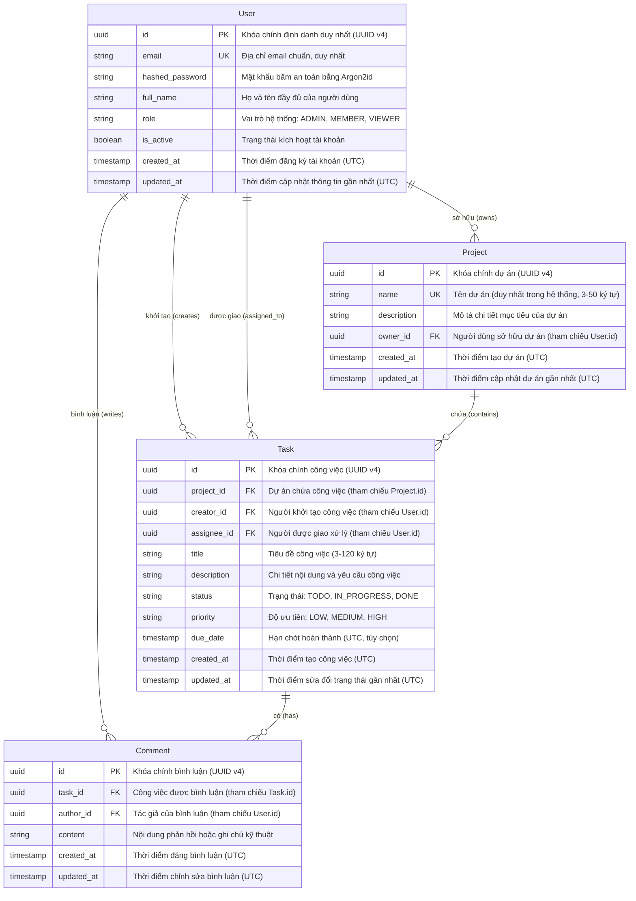

<!-- nav:top -->
[🏠 Home](../README.md) › Dự án TaskFlow
<!-- /nav:top -->

# 🚀 Dự Án Thực Hành Xuyên Suốt: TaskFlow API

> **Đồ án thực chiến phân tầng qua 4 cột mốc tiến hóa:** Từ công cụ CLI dòng lệnh thuần túy, nâng cấp thành RESTful CRUD API in-memory, chuyển mình thành Production-Ready Backend với PostgreSQL/Docker/JWT, và đạt tới đỉnh cao Scalable Distributed Architecture với Redis, ARQ, WebSockets, OpenTelemetry và Kubernetes.

---

## 📌 Bối cảnh Nghiệp vụ & Bài toán Cần giải quyết (Business Problem Statement)

Trong quy trình phát triển sản phẩm kỹ thuật số hiện đại, năng lực quản lý dự án và điều phối công việc theo thời gian thực (Collaborative Task & Project Management) là xương sống của mọi tổ chức công nghệ. Từ Jira, Asana, Trello đến Linear hay ClickUp, bản chất của các nền tảng này là giải quyết bài toán:
1. **Quản lý phân cấp thực thể nghiệp vụ**: Không gian làm việc (Workspaces), Dự án (`Project`), Công việc (`Task`) và Tương tác thảo luận (`Comment`).
2. **Kiểm soát truy cập & Phân quyền bảo mật**: Phân định rạch ròi giữa người tạo (Creator), người thực hiện (Assignee), chủ sở hữu (Owner) và các vai trò hệ thống (`ADMIN`, `MEMBER`, `VIEWER`), triệt tiêu triệt để lỗ hổng BOLA / IDOR.
3. **Tính nhất quán & Chống trùng lặp**: Đảm bảo các tác vụ phê duyệt, cập nhật trạng thái hoặc thanh toán nâng cấp gói đăng ký không bị trùng lặp khi mạng chập chờn (Idempotency).
4. **Hiệu năng cao & Khả năng co giãn**: Xử lý hàng trăm ngàn người dùng truy vấn đồng thời, đẩy các tác vụ nặng (xuất báo cáo, gửi email, tổng hợp số liệu) ra hàng đợi ngầm (Task Queue), đồng thời phát sóng cập nhật sự kiện tức thời qua kết nối 2 chiều (WebSockets / SSE).

Thay vì tiếp cận từng công nghệ một cách rời rạc qua các ví dụ "Hello World", lộ trình này dẫn dắt bạn xây dựng **TaskFlow API** như một đồ án xuyên suốt. Mã nguồn của cột mốc trước trở thành nền tảng trực tiếp để bạn refactor, mở rộng và hoàn thiện trong cột mốc kế tiếp.

---

## 🗄️ Mô hình Thực thể Quan hệ (Entity Relationship Diagram)

Sơ đồ ER dưới đây thể hiện 4 thực thể cốt lõi của TaskFlow API trong cơ sở dữ liệu quan hệ, thiết kế tuân thủ chuẩn khóa chính UUID v4, kiểm soát khóa ngoại và các trường kiểm toán thời gian (`created_at`, `updated_at`):



---

## 🗺️ Bản đồ Điều hướng 4 Cột mốc (Milestones)

Lộ trình thực hiện TaskFlow được chia làm 4 cột mốc rõ rệt tương ứng với từng giai đoạn trưởng thành kỹ thuật:

| Cột mốc | Tên Đồ án | Trọng tâm Kỹ thuật | Liên kết Chi tiết |
|:---:|---|---|:---:|
| **M0** | **CLI Task Manager** | Python thuần túy 3.12+, Standard Library (`argparse`, `@dataclass`, `json`, `pathlib`), CRUD file cục bộ. | [`./m0-cli-task-manager.md`](./m0-cli-task-manager.md) |
| **M1** | **RESTful CRUD API** | FastAPI, Pydantic v2, In-Memory Repository, Dependency Injection, RFC 9457 Problem Details, Pytest TestClient. | [`./m1-crud-api.md`](./m1-crud-api.md) |
| **M2** | **Production-Ready API** | PostgreSQL 17, SQLAlchemy 2.0 Async, Alembic migrations, JWT + Argon2, RBAC, Docker Compose, CI Pipeline. | [`./m2-production-api.md`](./m2-production-api.md) |
| **M3** | **Scalable Distributed API** | Clean Architecture, Redis Caching, Distributed Locks, Idempotency, ARQ Worker, WebSockets, OpenTelemetry. | [`./m3-scalable-api.md`](./m3-scalable-api.md) |

---

## 📈 Tiến hóa Kiến trúc qua 4 Cột mốc

Hành trình tiến hóa của TaskFlow mô phỏng sát sao con đường phát triển thực tế của một sản phẩm công nghệ từ nguyên mẫu (prototype) đến quy mô doanh nghiệp lớn (enterprise scale):

```
+------------------------------------------------------------------------------------+
|                               TIẾN HÓA KIẾN TRÚC TASKFLOW                          |
|                                                                                    |
|  [M0: CLI]                                                                         |
|  Terminal ---> argparse ---> TaskService ---> JsonFileRepository ---> tasks.json   |
|                                                                                    |
|  [M1: CRUD API In-Memory]                                                          |
|  HTTP Client ---> FastAPI Routers ---> Domain Services ---> InMemoryRepo (Dict)    |
|                         ^ (Dependency Injection)                                   |
|                                                                                    |
|  [M2: Production Enterprise API]                                                   |
|  HTTP Client ---> Nginx/Uvicorn ---> FastAPI (JWT/RBAC) ---> SQLAlchemy AsyncORM   |
|                                                                    |               |
|                                                                    v               |
|                                                             PostgreSQL 17          |
|                                                             (Alembic Migrations)   |
|                                                                                    |
|  [M3: Scalable Distributed Architecture]                                           |
|  HTTP / WS ---> Ingress / Cloudflare                                               |
|                      |                                                             |
|         +------------+------------+                                                |
|         v                         v                                                |
|    FastAPI Pods             WebSocket Pods <--- Redis Pub/Sub Backplane            |
|    (Idempotent, RateLimited)      |                                                |
|         |                         |                                                |
|         +------------+------------+                                                |
|                      v                                                             |
|    PostgreSQL + Redis Cache + ARQ Queue ---> ARQ Background Worker Pods            |
|                                                    (Exports, Digest, Emails)       |
|    [OpenTelemetry Collector ---> Prometheus + Grafana + Tempo Traces]              |
+------------------------------------------------------------------------------------+
```

### 1. Milestone M0 – Nền tảng Hướng đối tượng & Xử lý File cục bộ (Fresher)
- **Mục tiêu**: Xây dựng công cụ quản lý công việc cá nhân chạy trong Terminal, làm quen với kiểu dữ liệu, cấu trúc điều khiển, xử lý ngoại lệ và mô hình hóa dữ liệu bằng Standard Library.
- **Tầng lưu trữ**: Lưu trữ tuần tự hóa JSON vào đĩa cứng (`tasks.json`) với cơ chế ghi an toàn (Atomic File Write tránh hỏng file khi gặp crash).
- **Học được gì**: Nắm vững `@dataclass`, `argparse`, `pathlib.Path`, xử lý chuỗi thời gian `datetime`, và phân tách rõ ràng giữa tầng hiển thị (CLI output) và tầng lưu trữ dữ liệu.

### 2. Milestone M1 – Chuyển đổi sang Web API với FastAPI & Pydantic v2 (Junior)
- **Mục tiêu**: Đóng gói logic nghiệp vụ vào Web Service RESTful đạt chuẩn, hỗ trợ nhiều client tương tác qua giao thức HTTP/1.1 và HTTP/2.
- **Mở rộng miền nghiệp vụ**: Giới thiệu thực thể `Project` có quan hệ 1-Nhiều với `Task`.
- **Hệ thống hóa**: Áp dụng Dependency Injection (`Depends`) của FastAPI, kiểm thực chặt chẽ đầu vào bằng Pydantic v2, chuẩn hóa lỗi phản hồi theo chuẩn quốc tế RFC 9457 Problem Details, và viết bộ kiểm thử tự động với `pytest` đạt độ bao phủ cao.

### 3. Milestone M2 – Sẵn sàng Vận hành Doanh nghiệp (Middle)
- **Mục tiêu**: Đưa TaskFlow lên tiêu chuẩn Production với độ bền vững dữ liệu cao, bảo mật danh tính người dùng và quy trình triển khai tự động hóa.
- **Chuyển dịch cơ sở dữ liệu**: Thay thế bộ nhớ RAM bằng **PostgreSQL 17** bất đồng bộ qua **SQLAlchemy 2.0 ORM** (`asyncpg`). Quản lý lịch sử thay đổi cấu trúc bảng bằng **Alembic**.
- **Bảo mật & Phân quyền**: Bổ sung thực thể `User`. Cài đặt mã hóa mật khẩu bằng **Argon2id**, xác thực Stateless qua **JWT Access/Refresh Tokens**, kết hợp kiểm soát quyền đa tầng: Role-Based Access Control (RBAC) và Object-Level Authorization (phòng chống triệt để BOLA/IDOR).
- **Đóng gói & CI/CD**: Xây dựng Dockerfile Multi-stage siêu nhẹ với `uv`, điều phối môi trường cục bộ qua Docker Compose, và tự động hóa kiểm thử trên GitHub Actions.

### 4. Milestone M3 – Hệ thống Phân tán Siêu quy mô (Senior)
- **Mục tiêu**: Kiến trúc hóa TaskFlow để xử lý hàng triệu bản ghi, phục vụ tải cao với độ trễ thấp, kết hợp thời gian thực và tự động mở rộng cụm máy chủ.
- **Kiến trúc Clean / Hexagonal**: Tách biệt Domain Model khỏi Framework và Database thông qua Repositories Interface và Unit of Work Pattern.
- **Bộ nhớ đệm & Chống quá tải**: Cài đặt Redis Cache-Aside có chống Cache Stampede (Mutex Distributed Lock), phân trang con trỏ Keyset Cursor Pagination $O(1)$ thay thế Offset Pagination truyền thống.
- **Bất đồng bộ hóa tác vụ nặng**: Tách các tác vụ báo cáo, gửi thông báo sang cụm Worker **ARQ** xử lý ngầm, giao tiếp qua Redis Queue.
- **Tính năng thời gian thực**: Thiết lập kênh **WebSockets / SSE** cập nhật thay đổi tức thì cho người dùng, sử dụng Redis Pub/Sub làm message backplane xuyên suốt nhiều Pods.
- **Độ tin cậy & Giám sát**: Triển khai cơ chế Idempotency chống gửi lặp request, Distributed Rate Limiting bằng Redis Lua Script, và thiết lập Tracing / Metrics toàn diện với **OpenTelemetry**, Prometheus và Grafana.

---

## 📊 Bảng So sánh Tiến hóa Công nghệ qua các Milestone

| Tiêu chí / Khía cạnh | M0 (CLI Tool) | M1 (CRUD In-Memory) | M2 (Production API) | M3 (Scalable Distributed) |
|---|---|---|---|---|
| **Cấp độ kỹ năng** | Level 01: Fresher | Level 02: Junior | Level 03: Middle | Level 04: Senior |
| **Giao thức tương tác** | Dòng lệnh CLI (`argparse`) | RESTful HTTP JSON | RESTful HTTP JSON + JWT | REST HTTP + WebSockets / SSE |
| **Framework Web** | *Không sử dụng* | FastAPI + Uvicorn | FastAPI + Uvicorn (Workers) | FastAPI + Multi-Pod ASGI Nodes |
| **Mô hình Dữ liệu** | Python `@dataclass` | Pydantic v2 `BaseModel` | Pydantic v2 + SQLAlchemy 2.0 ORM | Clean Domain Entities + Ports/Adapters |
| **Tầng Lưu trữ (Persistence)** | JSON File (`tasks.json`) | In-Memory (`dict[UUID, Entity]`) | PostgreSQL 17 (`asyncpg`) | PostgreSQL Primary/Replica + Redis 7 |
| **Di chuyển Lược đồ (Migration)**| Thủ công / Không có | Không có | Alembic (Auto-generate revision) | Alembic Zero-Downtime Safe Migrations |
| **Xác thực & Phân quyền** | Single-user cục bộ | Không xác thực | JWT (Argon2) + RBAC + BOLA Guard | JWT + Fine-grained Scopes + Distributed ACL |
| **Concurrency & Async** | Synchronous thuần túy | Asynchronous Event Loop | Async I/O (AsyncSession, asyncpg) | Async I/O + Multiprocess ARQ Workers |
| **Bộ nhớ đệm (Caching)** | Không có | Không có | Không có | Redis Cache-Aside + Distributed Locks |
| **Xử lý Tác vụ Nền** | Không có | Không có | FastAPI `BackgroundTasks` | ARQ Distributed Queue + Cron Scheduler |
| **Khả năng Chống lặp (Idempotency)**| Không có | Không có | Database Unique Constraints | Distributed Idempotency Key (Redis + Hash) |
| **Kiểm soát Tần suất (Rate Limit)** | Không có | Không có | Không có | Distributed Sliding Window (Redis Lua Script) |
| **Giám sát (Observability)** | `print()` ra console | Standard Logging | Structured JSON Logging + Request ID | OpenTelemetry Traces + Prometheus Metrics |
| **Kiểm thử Tự động** | `unittest` / `pytest` cơ bản | `pytest` + `TestClient` | `pytest-asyncio` + Test DB Fixtures | Contract Tests + Stress Test Locust / k6 |
| **Đóng gói & Vận hành** | Chạy trực tiếp `python -m` | Virtualenv cục bộ (`uv`) | Multi-stage Dockerfile + Compose | Kubernetes Helm Charts + HPA Auto-scaling |

---

## 🛠️ Hướng dẫn Khởi động Nhanh Dự án

Dự án TaskFlow sử dụng công cụ quản lý gói siêu tốc `uv`. Để chuẩn bị môi trường cho toàn bộ hành trình:

```bash
# 1. Di chuyển vào thư mục dự án
cd project

# 2. Khởi tạo môi trường ảo với Python 3.12+
uv venv --python 3.12

# 3. Kích hoạt môi trường ảo
source .venv/bin/activate  # Trên Linux/macOS
# hoặc: .venv\Scripts\activate  # Trên Windows PowerShell

# 4. Cài đặt các gói phụ thuộc cần thiết cho từng milestone
uv add fastapi "uvicorn[standard]" "pydantic>=2.7" "sqlalchemy[asyncio]>=2.0" asyncpg alembic redis arq
```

Bắt đầu ngay với cột mốc đầu tiên: 👉 **[`Milestone M0: CLI Task Manager`](./m0-cli-task-manager.md)**!

<!-- nav:bottom -->
---

[🏠 Về trang chủ](../README.md)
<!-- /nav:bottom -->
